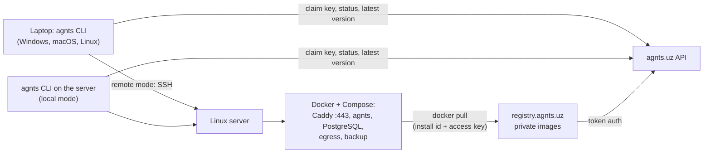

# agnts CLI — Plan

Oct 6, 2026 · @Rustam

## Overview

Today, getting agnts onto a server is the README's Deploy section: install Docker, copy `deploy/`, fill in `.env` by hand, generate keys, build the runner image, `compose up`, then `exec` into the container to create a user. It takes about an hour and every step can go wrong.

The agnts CLI is one Rust binary. It works in two modes:

- **Remote:** run it on your laptop (Windows, macOS or Linux), point it at a Linux server, and it installs and manages agnts there over SSH.
- **Local:** run it on the Linux server itself, and it installs and manages agnts right there.

Both modes run the same install steps. The user brings a fresh Linux server, a domain and an access key from their agnts.uz cabinet. The CLI does the rest: Docker, firewall, config, secrets, HTTPS, the admin user. After that it is how you upgrade, back up, read logs and run server commands.

```
# Remote: from your laptop
$ curl -fsSL https://agnts.uz/install.sh | sh        # Windows: irm https://agnts.uz/install.ps1 | iex
$ agnts install root@203.0.113.10 --domain agnts.acme.com

# Local: on the server itself
$ curl -fsSL https://agnts.uz/install.sh | sh
$ sudo agnts install --local --domain agnts.acme.com
```

The CLI binary is called `agnts`, the same as the server binary inside the container. Server commands go through `agnts server -- ...`.

**Goals**

- From a fresh server to the login page in under 10 minutes. The only manual step is the DNS record, and the CLI says exactly which record to create and waits for it.
- Safe to re-run: every step checks state first, so a failed install resumes where it stopped.
- When agnts.uz or the registry is briefly down, the CLI says so, asks you to wait 1–2 minutes, and carries on by itself.
- The CLI owns the day-2 work the README leaves to the user: upgrades, off-server backups, keeping `AGNTS_ENC_KEY` safe.

**Out of scope for v1:** hosting agnts on macOS or Windows (the CLI runs there, but only to manage Linux servers), creating the VPS itself, Kubernetes, more than one server per install.

**Principles**

1. Agentless. In remote mode the CLI talks to the server over plain SSH; nothing extra runs there besides the Compose stack.
2. One set of steps, two transports. Every step talks to a `Target`; `SshTarget` and `LocalTarget` are the only difference between the modes.
3. `deploy/` stays the single source of truth. The CLI embeds those files at build time, so the CLI version and the stack it writes always match.
4. Secrets are made where the CLI runs and written to the server with `0600`. In remote mode the encryption key is also kept on the laptop (the "off-server copy" the README asks for).
5. Every action is shown before it runs (`--dry-run` prints the full plan).

## How it works



### Modes

| | Remote | Local |
| --- | --- | --- |
| Started by | `agnts install user@host` | `sudo agnts install --local` |
| CLI runs on | Windows, macOS, Linux | The Linux server |
| Commands run through | `SshTarget` (system `ssh`) | `LocalTarget` (`std::process::Command`) |
| Key backup | Saved in the laptop profile | Printed once with a prompt to store it in a password manager (it is on the same server, so it is not an off-site copy) |
| Later commands | Use the profile: `agnts status --profile work` | Find the install in `/opt/agnts`: `agnts status` |

Supported servers: Ubuntu 22.04/24.04 and Debian 12, amd64 (arm64 once images are multi-arch). Install directory: `/opt/agnts` in both modes.

Steps are written as argument lists (`["docker", "compose", "up", "-d"]`), not shell strings. `SshTarget` quotes them for the remote shell; `LocalTarget` runs them directly.

### `agnts install` step by step

Each step is a `Step` with `check()` and `apply()`. `check()` reads server state; `apply()` runs only when the check says it is needed. Progress is recorded in `/opt/agnts/.install-state.json` so a re-run skips finished steps.

| # | Step | What it does | Check |
| --- | --- | --- | --- |
| 1 | Connect | Remote: SSH connects; host key fingerprint shown on first connect (trust on first use); non-root users need passwordless sudo. Local: running as root or with sudo. Runs first so a resumed install can load its saved answers. | — |
| 2 | Ask | Domain (required), access key, ACME email, git author name/email, admin username. Every answer also has a flag (`--key`, `--domain`, …) or env var (`AGNTS_KEY`) for non-interactive use; a resumed install reuses saved answers. | — |
| 3 | Preflight | Supported OS and arch; ≥2 GB RAM, ≥20 GB disk; ports 80/443 free. Fails with a clear fix for each. | — |
| 4 | Claim key | Read or create this server's install id (`/opt/agnts/install-id`, a random UUID), then `POST /api/installs/claim` with the key, install id and domain. agnts.uz binds the key to this install. See [Access keys](#access-keys). | Key bound to this install id |
| 5 | Docker | Docker Engine + Compose plugin from Docker's apt repo, service enabled, `DOCKER_GID` read. | `docker compose version` |
| 6 | Firewall | `ufw allow 22,80,443/tcp` and `443/udp`; enable. Skipped with `--no-firewall`. | `ufw status` |
| 7 | DNS | Detect the server's public IP. Show the exact `A`/`AAAA` record to create at the user's DNS provider, then poll public resolvers until the domain points at that IP. Enter re-checks immediately; `--skip-dns-check` for split-horizon setups. | Domain resolves to the server IP |
| 8 | Reachability | `agnts.uz/api/probe` connects back to `http://<domain>/` on port 80 from outside. This catches closed ports and provider firewalls before Let's Encrypt does. | Probe reaches the server |
| 9 | Files | Write `docker-compose.yml`, `Caddyfile`, `backup.sh` from the embedded copies. | Hashes match |
| 10 | Secrets + `.env` | Generate `POSTGRES_PASSWORD` and `AGNTS_ENC_KEY` (32 random bytes, base64, same as `agnts keygen`). Write `.env` with `0600`. Remote mode also saves the key to the laptop profile. | `.env` exists: never overwritten, only missing keys added |
| 11 | Images | `docker login registry.agnts.uz` with the install id as username and the access key on stdin as password, then `docker compose --profile build pull agnts egress runner` at the CLI's version tag. If the registry is down, wait and retry. | Image digests present |
| 12 | Start | `docker compose up -d`; wait for `agnts` healthy. | `compose ps` |
| 13 | HTTPS | Poll `https://<domain>/healthz` until Caddy has a certificate (timeout with a DNS/port hint). | 200 |
| 14 | Admin user | `docker compose exec agnts agnts user create <name>` with a TTY, so the existing password + TOTP prompts work unchanged. With no terminal it is skipped with the command to run later. | User exists |
| 15 | Done | Save the profile; report version and status to agnts.uz (the install shows in the cabinet); print the URL and the next three things to connect (Claude, GitHub, Jira). | — |

### When agnts.uz or the registry is down

Every call to agnts.uz and every image pull goes through one retry helper:

1. A connection error, timeout, `502`/`503`/`504`, or a `docker pull` error that names the registry counts as "temporarily down". A `401`/`403`/`409` (bad, revoked or already-used key) does not: that fails at once with a link to the cabinet.
2. The CLI prints:
   ```
   agnts.uz is temporarily unavailable (registry.agnts.uz: 503).
   This usually takes 1–2 minutes. Waiting and retrying automatically…  ⠋ 0:42
   ```
   It retries every 10 seconds, using `Retry-After` when the server sends one.
3. After 3 minutes it asks `Still down. Keep waiting? [Y/n]`. With `--yes` it keeps waiting up to 10 minutes, then exits with code 75 (temporary failure).
4. Nothing is lost: install state is saved before each step, so stopping and running `agnts install` again later continues from the step that was waiting.

agnts.uz serves `GET /api/status` (`{"status":"ok"|"maintenance","retry_after":90,"message":"..."}`) so planned maintenance shows its own message and wait time instead of a generic error. A running agnts install never calls agnts.uz, so downtime only affects install, upgrade and key checks.

### Access keys

Users create keys in the agnts.uz cabinet (`agnts.uz/cabinet/keys`). **One key is good for one install.**

- **Binding.** Each server gets an install id (random UUID in `/opt/agnts/install-id`, made on first install). The first `claim` binds the key to that id and records the domain. Claiming again with the same id is a no-op, so re-runs and resumed installs just work.
- **Already used.** Claiming with a different install id fails with `409`:
  ```
  This key is already used by the install at agnts.acme.com.
  Create a new key at https://agnts.uz/cabinet/keys, or move this key with --move.
  ```
- **Moving to a new server.** `agnts install --move` (or "Release" in the cabinet) rebinds the key to the new install id. The old install keeps running but can no longer pull or upgrade. This is the path for server migrations, used together with `agnts backup --pull` and `agnts restore`.
- **Enforced by the registry.** The server logs in to the registry with the install id as username and the key as password. agnts.uz's token service only issues pull tokens when that pair matches the binding, so a copied key does not work on a second server without moving it.
- **Storage.** In remote mode the laptop keeps the key in the OS keychain (macOS Keychain, Windows Credential Manager, Linux Secret Service, `0600` file fallback). On the server it is stored only as Docker's registry credential (`/root/.docker/config.json`, `0600`).
- `agnts key set` swaps in a new key for the same install. A revoked key stops future pulls and upgrades but never stops a running install.
- `agnts uninstall --purge` releases the key so it can be used again.

### Commands

| Command | What |
| --- | --- |
| `agnts install [user@host \| --local]` | The flow above. `--domain` (required), `--key`, `--email`, `--move`, `--yes`, `--dry-run`, `--version`, `--no-firewall`. |
| `agnts status` | Containers, versions, health, cert expiry, disk use, last backup. |
| `agnts upgrade [--version X]` | Write the new embedded files, pull images, `up -d`, wait for health. Takes a backup first; rolls back the image tag if health fails. |
| `agnts logs [service] [-f]` | `docker compose logs` streamed back. |
| `agnts backup [--pull]` | Run `pg_dump` now; `--pull` (remote mode) copies backups to the laptop. |
| `agnts restore <file>` | Restore a dump, with a confirm prompt. |
| `agnts env get/set KEY [VALUE]` | Edit `.env` safely, then restart `agnts`. |
| `agnts domain set <domain>` | Move to another domain: DNS check, update `AGNTS_DOMAIN` and `AGNTS_PUBLIC_URL`, update the cabinet, restart, wait for the certificate, list the webhooks to update (Jira, GitHub/GitLab, Claude connector). |
| `agnts key set` | Replace the access key for this install. |
| `agnts server -- <args>` | Pass through to the server binary: `agnts server -- integration set claude`, `-- repo add ...`, `-- mcp token`. |
| `agnts doctor` | Re-run every preflight and check against a running install. |
| `agnts ssh` | Remote mode: open a shell in `/opt/agnts`. |
| `agnts uninstall` | Stop the stack; keeps volumes unless `--purge` (typed confirmation, also releases the key). |
| `agnts self-update` | Update the CLI from agnts.uz (same retry behaviour when it is down). |

Profiles live in the OS config directory (`~/.config/agnts`, `~/Library/Application Support/agnts`, `%APPDATA%\agnts`) as `config.toml`: one entry per install with mode, host, domain, install id and version. `--profile` picks one; with no profile and `/opt/agnts` on this machine, commands use local mode.

## Code

New top-level `cli/` directory, one crate:

```
cli/
  Cargo.toml
  build.rs              # fails the build if deploy/ files are missing
  src/
    main.rs             # clap commands
    profile.rs          # config.toml, per-OS config paths
    target/
      mod.rs            # trait Target { run, run_tty, write_file, read_file }
      ssh.rs            # SshTarget: system OpenSSH via `openssh`
      local.rs          # LocalTarget: std::process
      fake.rs           # records commands, returns canned output (tests)
    cloud.rs            # agnts.uz API client + the retry helper
    keychain.rs         # access key storage on the CLI's machine
    assets.rs           # include_str!("../../deploy/...")
    env_file.rs         # parse/merge .env without losing comments
    steps/              # one file per install step, each impl Step
    cmd/                # install, upgrade, status, logs, backup, ...
    ui.rs               # prompts, spinners, colors
  tests/
```

**Crates:** `clap` (derive), `tokio`, `openssh` (wraps the system `ssh` with connection multiplexing, so `~/.ssh/config`, agents, ProxyJump and known_hosts all just work), `inquire` (prompts), `indicatif` (progress), `serde` + `toml`, `directories`, `keyring`, `uuid`, `rand` + `base64`, `hickory-resolver` (DNS check), `reqwest` with rustls (agnts.uz API, health polling), `backon` (retry), `anyhow`, `self_update`.

Why system OpenSSH rather than a pure-Rust SSH client: users already have keys, agents, bastions and hardware keys set up for it, and copying all that is the most common source of "works with ssh, fails with the tool". Windows 10+ ships OpenSSH. One catch: `openssh`'s connection multiplexing does not work on Windows, so `SshTarget` falls back to one `ssh` process per command there.

## Changes outside `cli/`

- **agnts.uz (website backend, a dependency of this plan):**
  - Cabinet: sign-in, create/revoke/release access keys, see which install each key is bound to (domain, version, last seen).
  - API (the CLI's contract; `cli/tests/support/stub.rs` implements it for tests): `POST /api/installs/claim` `{install_id, domain, move, cli_version}` (bind key to install id; idempotent; `401` unknown or revoked key; `409 {domain}` if bound elsewhere; `move: true` to rebind), `POST /api/installs/report` `{install_id, domain, version, event}`, `POST /api/installs/release` `{install_id}`, `POST /api/probe` `{url, expect}` → `{ok, error}`, `GET /api/ip` (caller's IP as text), `GET /api/status`, `GET /api/cli/latest` → `{version, assets: {<target triple>: {url, sha256}}}`, `POST /api/cli/releases?version=` (release upload, CI token). The key travels as `Authorization: Bearer`. Return `503` with `Retry-After` and `{message}` during maintenance.
  - Docker token service for the registry: issues pull tokens only for a matching install id + key pair.
  - Serves `install.sh`, `install.ps1` and the CLI binaries.
- **Registry at `registry.agnts.uz`:** a private Docker registry (`registry:2`, the open-source Distribution) behind Caddy, using the token service above; only CI may push. Layers on disk with a nightly off-server copy; S3-compatible storage once they outgrow it. Health-checked and monitored, since installs and upgrades depend on it.
- **CI release workflow:** on a `v*` tag, build the server and runner images with the version tag (today only `<sha>` and `latest`) and push them to `registry.agnts.uz`; build CLI binaries with `cargo-dist` for Linux (x86_64, arm64, musl), macOS (arm64, x86_64) and Windows (x86_64); upload them to agnts.uz.
- **CLI CI job:** `cargo fmt --check`, `clippy -D warnings` and `cargo test` on Ubuntu, macOS and Windows runners (the CLI runs on all three, even though servers are Linux only).
- **`.env.example`:** `AGNTS_IMAGE` and `AGNTS_RUNNER_IMAGE` point at `registry.agnts.uz/agnts` and `registry.agnts.uz/agnts-runner`, replacing `ghcr.io/OWNER`. It also becomes the template the CLI fills in, so it keeps one key per line with comments above it.
- **Server:** `agnts version --json` for `status`. (`user create --password-stdin` was dropped: the user still has to enter the code from their authenticator app, so creating the admin user needs a terminal either way.)
- **README:** Deploy section becomes "install the CLI, `agnts install`", with the manual steps kept below as "Manual install". The CLI examples become `agnts server -- integration set claude` and so on.
- The pinned `hiro_*` volume names in `docker-compose.yml` stay as they are, so the CLI can adopt an existing manual install (`agnts install` detects an existing `.env` and only fills gaps).

## Security

- Host key: trust on first use with the fingerprint shown; a changed key stops everything.
- `.env`, backups and the Docker credential are `0600`, owned by root. Secrets never go on a command line: they are written as file content or passed on stdin, so they do not show in `ps` or shell history.
- The registry accepts a key only together with the install id it is bound to.
- `--dry-run` lists every command and file before touching the server.
- `install.sh`, `install.ps1` and release binaries are checksummed and signed; `self-update` verifies them. The macOS binary is notarized and the Windows binary signed, so neither is blocked on first run.

## Roadmap

About 5.5 weeks at roughly 20 hours a week, plus the agnts.uz cabinet, token service and registry, which the install depends on from Phase 1. Until they exist, the CLI runs against a stub agnts.uz API and a test registry.

### Phase 0: Skeleton (3 days)

- [x] `cli/` crate, clap commands, profiles, `Target` trait with `SshTarget`, `LocalTarget` and the fake
- [x] `assets.rs` embedding `deploy/`; CI on Ubuntu, macOS and Windows
- [ ] Gate: `agnts doctor` runs against a test VM in remote mode (from macOS and Windows) and on the VM in local mode

### Phase 1: Install, both modes (2 weeks)

- [x] Steps 1–15 with check/apply and resumable state
- [x] Install id and key claim, including `409` and `--move`
- [x] DNS step with record instructions and polling; reachability probe
- [x] agnts.uz client with the retry helper and down/maintenance messages
- [x] `.env` merge that never overwrites existing values
- [x] `--dry-run`, `--yes` and all flags for non-interactive use
- [ ] Gate: fresh Ubuntu 24.04 VM to login page in under 10 minutes, once remote from a laptop and once local on the VM; a killed install resumes cleanly; with the stub API returning 503 for 90 seconds, the install waits and finishes by itself; the same key on a second VM is refused

### Phase 2: Day 2 (1 week)

- [x] `status`, `logs`, `upgrade` (with pre-upgrade backup and rollback), `backup --pull`, `restore`, `env`, `domain set`, `key set`, `server --`, `uninstall`
- [ ] Gate: upgrade between two tagged releases with no manual step; moving to a second VM with `backup --pull`, `install --move` and `restore` brings back tickets and secrets, and the old VM can no longer pull

### Phase 3: Release (1.5 weeks)

- [ ] Wire the CLI to the real cabinet API, token service and registry (the CLI side is done against the stub; agnts.uz still has to implement the API above)
- [x] Release workflow: versioned images pushed to `registry.agnts.uz`, CLI builds for 5 targets with checksums, GitHub Release, upload to agnts.uz, Homebrew tap formula (`.github/workflows/release.yml`; hand-written instead of `cargo-dist`)
- [x] `install.sh` / `install.ps1` with checksum checks; `self-update` with SHA-256 check
- [ ] Code signing and macOS notarization (needs an Apple Developer ID and a Windows signing certificate)
- [x] README rewrite
- [ ] Gate: someone who has not seen the project installs agnts from the README with only a server, a domain and an access key from the cabinet; a revoked key fails `upgrade` with a clear message

### Phase 4: Later

- [ ] Local mode on macOS and Windows (Docker Desktop)
- [ ] Sign in through the browser (device code approved in the cabinet) instead of pasting a key
- [ ] Multi-arch images and arm64 servers
- [ ] Scheduled off-site backups (from the laptop, or to S3-compatible storage)

## Status (Oct 6, 2026)

Built: the whole CLI in `cli/` (Phases 0–2 and the CLI side of Phase 3). Checks: 34 unit and integration tests, clippy and rustfmt clean, a CI job on Linux, macOS and Windows.

Tried for real against an Ubuntu 24.04 container over SSH (non-root user with sudo), with the stub agnts.uz and a local registry:
- trust-on-first-use host keys
- preflight
- key claim, including waiting through a 25-second outage
- refusing the same key on a second server, and `--move`
- stack files, `.env` (0600, existing secrets kept on resume)
- `docker login` and image pulls
- `status`, `doctor`, `env` and `self-update --check`

Not yet tried for real:
- **Starting the stack, HTTPS and the admin user.** They need a real VM and domain (the Phase 1 gate).
- **The Docker install itself.** The container already had Docker.
- **ufw and the reachability probe.**
- **`upgrade`, `backup`, `restore`, `domain set` and `uninstall` against running containers.**

Waiting on others:
- **agnts.uz:** the cabinet, the API and the registry token service.
- **Release secrets:** the registry push account, the release upload token, signing certificates.

## Testing

- **Unit:** every step against the fake `Target`: fresh server, half-installed server, existing manual install, each preflight failure, registry down then back, revoked key, key bound to another install.
- **Stub agnts.uz:** `make cli-stub` (or `cargo run --example stub_cloud`, with `STUB_DOWN_SECS=90` for the outage test) runs the API above; point the CLI at it with `AGNTS_CLOUD_URL`, and at a test registry with `AGNTS_REGISTRY`. The hidden `--ignore-preflight` flag lets test machines that fail the size checks continue.
- **Local-mode integration (CI, Ubuntu runner):** not built yet. Needs a way to serve HTTPS without Let's Encrypt (for example Caddy's internal CA) to get past step 13.
- **Remote E2E (manual trigger and before each release):** create a Hetzner VM, point `<run-id>.e2e.agnts.uz` at it through the DNS provider's API, run install and upgrade from Linux, macOS and Windows runners, delete the VM.

## Risks

- **agnts.uz and the registry are on the install path.** If they are down, nobody can install or upgrade (running installs are unaffected). The retry helper softens short outages; uptime monitoring and alerts on both are part of Phase 3.
- **DNS is the one manual step.** Users who have never created a DNS record get stuck here. The DNS step shows the exact record, and the docs need short guides for common providers (Cloudflare, Namecheap, ahost.uz, etc.).
- **Lost servers lock keys.** If a server dies before `uninstall`, its key stays bound. "Release" in the cabinet and `--move` cover this; support should know both.
- **Changing the domain later breaks webhooks.** Jira, GitHub/GitLab and the Claude connector store the old URL; `agnts domain set` lists exactly which ones to update.

## Decided

- The CLI binary is `agnts`; server commands go through `agnts server -- ...`.
- Website, installer and API: `agnts.uz`.
- Images are private, served from our own registry at `registry.agnts.uz`.
- Access keys are created in the agnts.uz cabinet. One key is good for one install; it is bound to the server's install id and can be moved.
- A domain is required; no sslip.io. The user creates the DNS record; the CLI says what to create and waits for it.
- When agnts.uz or the registry is down, the CLI says so, asks the user to wait 1–2 minutes, and retries by itself.
- Two modes: remote (over SSH) and local (on the server). Servers are Linux only for now; the CLI itself runs on Windows, macOS and Linux.
