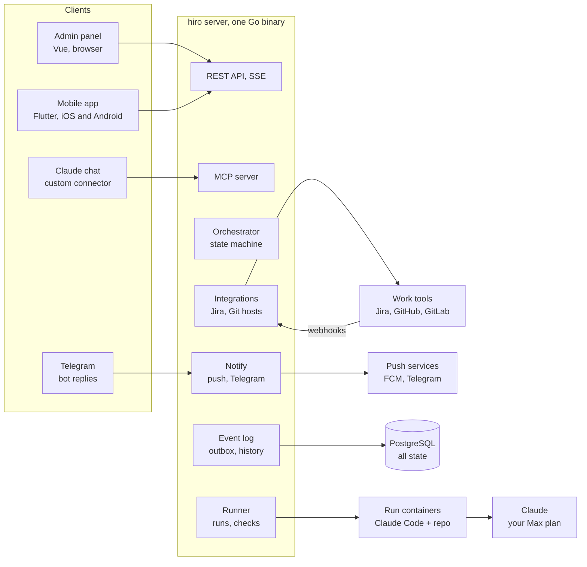
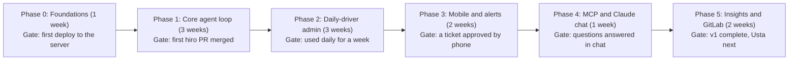

# hiro — Implementation Plan

Oct 4, 2026 · @Rustam

## Overview

hiro v1 is a self-hosted agent on one server: it takes Jira tickets and side-project tasks, codes them with Claude Code in isolated containers, and ships nothing without your approval. It is the working prototype for Usta, so every boundary below is drawn to survive the move to multi-user.

**In scope for v1**

- Pick up Jira tickets by label, plus local tasks for side-project repositories.
- Ask questions, code, test, and wait for your review before pushing to GitHub or GitLab.
- Admin panel (web), mobile app (iOS and Android), and an MCP server so you can manage hiro from Claude chat.
- Logs, analytics, plan-usage tracking, repository views (branches, commits, pipelines).

**Out of scope for v1:** multiple users or teams, billing, Bitbucket, Linear, Slack, running models other than Claude.

**Principles**

1. The human gates stay: no push without approval, no deploy from chat, no question skipped silently.
2. One source of truth: every state change is an event row; pages, push notifications and MCP all read the same API.
3. Claude Code is a replaceable worker behind an interface; hiro owns orchestration, checks and history.
4. Boring infrastructure: Go, PostgreSQL, Docker, one VPS. No Kubernetes, no queue service until it hurts.
5. Build the server first; the existing demos already define the UI, so the frontends are mostly wiring.

## Architecture

Everything runs on one Linux server behind Caddy (HTTPS): the Go binary, PostgreSQL and the Docker engine for run containers. The admin panel, the mobile app and Claude chat are three clients of the same use-case layer.

The REST API and MCP are the main entry points, with Jira, GitHub and GitLab webhooks and Telegram replies coming in through their adapters; run containers only reach Claude, the git host for cloning and package registries, while pushes, Jira updates and notifications always leave from the server.

## Server side

One Go binary with clear internal modules, PostgreSQL as the only stateful store, and Docker for run isolation. Clean Architecture: domain and use cases in the middle, adapters (Jira, GitHub, GitLab, Claude Code, push, Telegram) at the edges behind interfaces. Every inbound channel (REST, MCP, Telegram, webhooks) calls the same use cases.

### Modules

| Module | Responsibility | Key packages |
| --- | --- | --- |
| `api` | REST + SSE for admin panel and mobile; auth; OpenAPI spec (the contract both clients are generated from) | chi, oapi-codegen |
| `mcp` | MCP server (streamable HTTP) exposing hiro tools to Claude | modelcontextprotocol/go-sdk |
| `orchestrator` | Ticket state machine, scheduling, parallelism and plan-limit gating | domain + Postgres |
| `runner` | Starts a container per run, launches `claude -p`, parses stream-json, enforces turn and time limits | Docker Engine API |
| `checks` | Runs build, lint, tests inside the container; waits for CI on the hiro branch | runner |
| `vcs` | One interface for GitHub and GitLab: clone, branch, push, PR/MR, branches, commits, pipelines, webhooks | go-github, gitlab client |
| `tracker` | Jira: webhook receiver (issue created, updated, labeled, commented), transitions, comments; JQL reconcile on startup and hourly to catch missed deliveries | REST v3 client |
| `notify` | Push via FCM (which delivers to APNs for iOS); Telegram bot that sends alerts and accepts replies (answers, approve, request changes, reject) | firebase-admin-go, Telegram Bot API |
| `usage` | Stores `rate_limit_event` snapshots, idle refresh run, auto-pause and resume | runner |
| `events` | Append-only event log; feeds Logs, Analytics, history, SSE | Postgres |

### Ticket state machine

`new → analyzing → waiting_for_answers → coding → testing → waiting_for_review → pushing → done`, with side exits `rejected`, `failed` and `rate_limited`. Every transition is one function in the orchestrator that writes the new state and an event in the same transaction (outbox pattern), so SSE, push and analytics never miss a change.

### Runner

1. Clone the repository into a fresh container from a per-stack image (Go, Node, etc.), checkout `hiro/<key>`.
2. Write the prompt (ticket, plan, answers, extra instructions, CLAUDE.md is read by Claude Code itself).
3. Run `claude -p --output-format stream-json --verbose --model <stage model> --max-turns <limit>` with `CLAUDE_CODE_OAUTH_TOKEN` and the allow/deny settings file.
4. Stream every line: tool calls and messages become events, `rate_limit_event` goes to `usage`, the session id is saved so Request changes can `--resume` it.
5. On finish, `checks` runs build, lint and tests; failures loop back to Claude Code up to N times, then the ticket moves to `failed` with the output attached.
6. The diff is stored for review; the container is removed. Pushing happens only from `orchestrator` after approval, never from inside the container.

### Data model (PostgreSQL)

| Table | Main columns |
| --- | --- |
| `users` | username, password\_hash (Argon2id), totp\_secret\_enc, totp\_last\_step (blocks code replay) |
| `sessions` | token\_hash, user\_id, client (web, mobile), expires\_at |
| `tickets` | key, source (jira, local), repo\_id, title, description, priority, state, revision, turns, models jsonb, after (pr, main), pr\_number, timestamps |
| `questions` | ticket\_id, text, options jsonb, answer, note |
| `runs` | ticket\_id, stage, model, session\_id, container\_id, started\_at, finished\_at, turns, exit\_reason |
| `results` | run\_id, summary jsonb, tests jsonb, lint, files jsonb (path, add, del, diff) |
| `events` | ticket\_key, run\_id, step, type, level, message, data jsonb, duration\_ms, created\_at (indexed by ticket and time) |
| `repositories` | name, kind (jira, side), clone\_url, default\_branch, build, lint, test, prefix, claude\_md |
| `integrations` | provider, connected, token\_enc, settings jsonb, checked\_at |
| `usage_snapshots` | five\_hour, seven\_day, resets\_at, status, created\_at |
| `settings` | key, value jsonb (models by stage, limits, notifications) |
| `devices` | platform, fcm\_token, app\_version, last\_seen (for mobile push) |
| `telegram_messages` | chat\_id, message\_id, ticket\_key, kind (questions, review), created\_at (maps replies back to tickets) |
| `pending_actions` | id, origin (mcp, telegram), tool, args jsonb, summary, expires\_at, confirmed\_at (two-step writes) |
| `webhook_deliveries` | provider, delivery\_id (deduplicates Jira, GitHub, GitLab and Telegram deliveries) |

Analytics are SQL over `events` and `runs` (time per step, outcomes, stop reasons, model usage). If queries get slow, add a nightly rollup table; ClickHouse is not needed at this scale.

### MCP server

Served at `https://<your-domain>/mcp`, streamable HTTP, bearer token checked on every request, rate-limited.

- **Read tools:** `get_inbox`, `list_tickets`, `get_ticket`, `get_run_log`, `get_usage`, `get_analytics`, `list_repositories`, `get_repository`.
- **Write tools (two-step):** `answer_questions`, `start_run`, `request_changes`, `retry_run`, `create_task`, `approve_ticket`, `reject_ticket` each create a `pending_action` and return its summary; only `confirm_action(id)` executes. Pending actions expire after 10 minutes.
- **Not exposed:** deploys, disconnecting integrations, settings changes.
- Tool annotations: `readOnlyHint` on reads, `destructiveHint` on approve and reject.

The MCP tools call the same use-case layer as the REST API, so there is no second implementation of any action.

## Admin panel

A Vue single-page app built from the existing demo: the demo already fixes layout, pages, copy and translations, so the work is components plus API wiring.

**Stack:** Vue 3 (Composition API, `<script setup>`) + TypeScript + Vite, TanStack Query for Vue (`@tanstack/vue-query`) for server state, Vue Router, Pinia for the little client state there is (theme, language, session), a TypeScript API client generated from the server's OpenAPI spec, vue-i18n with the demo's EN/RU/UZ dictionaries (from `shared/i18n`), CSS variables from the demo for day and night themes. Charts: hand-written SVG components as in the demo, or vue-echarts if they grow. Served as static files by the Go binary.

**Live updates:** one Server-Sent Events stream (`/api/events/stream`) pushes event rows; the client invalidates the affected queries. Live logs subscribe per ticket.

| Page | Main endpoints |
| --- | --- |
| Dashboard | `GET /dashboard` (counts, waiting list, live runs, pipeline, today by hour) |
| Analytics | `GET /analytics?days=7\|30\|90` |
| Ticket lists, ticket page | `GET /tickets`, `GET /tickets/{key}`, `POST /tickets/{key}/analyze\|start\|stop\|approve\|request-changes\|reject\|retry\|resume`, `PUT /tickets/{key}/answers`, `PUT /tickets/{key}/models` |
| Tasks | `POST /tasks`, `PATCH /tasks/{key}`, `DELETE /tasks/{key}` |
| Logs | `GET /events?type=&key=&level=&cursor=`, `GET /events/export` |
| Plan usage | `GET /usage`, `POST /usage/refresh` |
| Integrations | `GET /integrations`, `POST /integrations/{p}/connect\|test\|disconnect\|sync`, `PUT /integrations/{p}` |
| Repositories, repository page | `GET /repos`, `GET /repos/{id}/branches\|commits\|pipelines`, `POST /repos/{id}/deploy` |
| Settings | `GET /settings`, `PUT /settings` |

**Auth:** single user, password plus TOTP, session cookie (HttpOnly, SameSite=Strict). Designed so a `users` table can be added for Usta without changing the API shape.

**Page docs:** keep the per-page help texts as Markdown files per language, loaded by the How this page works panel, so they can be edited without a deploy.

## Mobile app

Flutter, one Dart codebase for iOS and Android. It shares no code with the Vue admin panel; what keeps them in sync is the OpenAPI spec (a Dart client is generated from it, as the TypeScript one is for admin) and the EN/RU/UZ dictionaries in `shared/i18n`, converted to ARB files at build time.

**Stack:** Flutter (stable channel at build time), Riverpod for state and server data, go\_router with deep links, a Dart client generated with openapi-generator (`dart-dio`), flutter\_localizations + intl (ARB generated from `shared/i18n`), `firebase_messaging` for push, `flutter_secure_storage` for the session token, a hand-written SSE listener for live updates while the app is open. Theme tokens are copied from the demo's CSS variables into a `ThemeData` for day and night. Monorepo: `server/`, `apps/admin` (Vue), `apps/mobile` (Flutter), `shared/openapi` (spec), `shared/i18n` (JSON dictionaries); a `make gen` target regenerates both clients and the ARB files, and CI fails if they are stale.

**Screens (from the demo):** Home (dashboard), Tickets, Tasks, Analytics with Events, More (usage, appearance, default models, push settings, integrations, repositories), ticket screen with pinned action bar, repository screen with branches, commits and pipelines.

**Push notifications**

1. The app gets its FCM token via `firebase_messaging` and registers it with `POST /devices` (and again whenever the token refreshes).
2. On transitions to `waiting_for_answers`, `waiting_for_review`, `failed`, `rate_limited` and `done`, `notify` sends a push with the ticket key as a deep link.
3. Tapping opens the ticket screen directly; per-event switches in More decide what is sent.
4. Telegram uses the same trigger, so both channels stay consistent.

**Telegram replies**

- Questions arrive with inline buttons for each option; a text reply to the message is taken as a free-form answer or note.
- Review messages carry Approve, Request changes and Reject buttons; Request changes asks for the feedback text as a reply.
- Approve and Reject are two-step: the button creates a `pending_action` and the bot asks to confirm, same as MCP.
- The bot is bound to your chat id; updates from any other chat are ignored and logged.

**Distribution:** for personal use, TestFlight (iOS) and an internal APK or Play internal testing track (Android). Store review is only needed once Usta goes to clients.

**Deferred to after v1:** voice input for answering questions, offline cache, widgets.

## Security and safety

The agent runs arbitrary code from tickets, so the container is treated as untrusted and every outbound action goes through hiro, not Claude Code.

- **Containers:** one per run, non-root user, read-only base image, CPU and memory limits, no Docker socket, network limited to the git host, package registries and the Claude API. Destroyed after the run.
- **Secrets:** Jira, GitHub, GitLab and Claude tokens live encrypted in Postgres (AES-GCM, key from an env var), injected only where needed. The coding container gets the Claude token and a read-only clone, never the push token.
- **Claude Code permissions:** allow and deny lists from Settings written to the container's settings file; `git push`, `curl`, `wget` and reading `.env` are always denied.
- **Human gates:** push only after Approve; production deploys only from the admin panel or mobile app; MCP and Telegram writes are two-step with expiring confirmations.
- **Public surface:** only the HTTPS reverse proxy (Caddy) is exposed, serving the admin panel, API, `/mcp` and webhook endpoints (Jira, GitHub, GitLab, Telegram). Webhooks verify signatures (Jira shared-secret HMAC, GitHub HMAC, GitLab secret token, Telegram `secret_token` header); deliveries are deduplicated by id.
- **Auth:** admin and mobile via password plus TOTP; MCP via a separate long random bearer token you can rotate; API rate limits per route.
- **Company code:** confirm with your employer that sending code to the Claude API under your subscription is acceptable before connecting work repositories.
- **Audit:** every action, from UI, mobile, MCP or Telegram, is an event with its origin, so the Logs page shows who or what did it.

## Roadmap

Six phases, about 12 weeks at roughly 20 hours a week; each phase ends at a gate you can verify. Phase 1 is the one that matters: after it, hiro already takes a real Jira ticket to a merged PR, and everything later improves how you work with it.

The diamond under each phase is its gate; the next phase starts only after it passes.

### Phase 0: Foundations

- [x] Monorepo: `server/`, `apps/admin`, `apps/mobile`, `shared/openapi`, `shared/i18n`; `make gen` for the TypeScript client, Dart client and ARB files
- [x] Go skeleton with Clean Architecture layout, config, slog logging (Go 1.26)
- [x] PostgreSQL with migrations (goose), the tables from the data model
- [ ] Caddy with HTTPS on your domain (config ready, waiting on a domain and server), single-user auth (password plus TOTP, done)
- [ ] CI: lint, tests, build image; deploy with Docker Compose; nightly `pg_dump` (written, first run when pushed to GitHub)

### Phase 1: Core agent loop

- [x] Jira adapter: webhook endpoint with signature check, pick up by label, JQL reconcile, read ticket, post comments
- [x] Orchestrator state machine with event outbox
- [x] Runner: container per run, `claude -p` with stream-json, turn and time limits, session resume
- [x] Checks: build, lint, tests inside the container, retry loop, failure output saved
- [x] GitHub adapter: branch `hiro/<key>`, commit as you, push, open PR, Jira transition
- [x] Minimal admin: ticket list, ticket page with questions, live log, diff review, approve or request changes
- [ ] Gate: build the runner image on the server, connect Claude, GitHub and Jira, and merge the first hiro PR (everything above is tested against fakes, local git and local Docker; nothing has run against the real services yet)

### Phase 2: Daily-driver admin

- [x] Port the demo pages: Dashboard, lists, Tasks, Logs, Plan usage, Repositories, Settings, Integrations (Jira and GitHub)
- [x] SSE live updates; models by stage and per-ticket overrides
- [x] `rate_limit_event` tracking, auto-pause and resume, idle refresh run
- [x] Side-project tasks with push to main or PR
- [x] Day and night themes, EN/RU/UZ, page docs
- [ ] Gate: used daily for a week

### Phase 3: Mobile and alerts

- [x] Flutter app with the demo's tabs and ticket screen, generated Dart client, ARB translations, day and night themes (written and syntax-checked; first compile happens in CI or after `flutter upgrade`)
- [x] Device registration, push on the five notify states (FCM HTTP v1), deep links via go\_router
- [ ] Firebase project, APNs key uploaded to FCM (your accounts)
- [x] Telegram bot: notifications with the same triggers, replies for answers and review (two-step approve and reject)
- [ ] TestFlight and Android internal track builds (your accounts)
- [ ] Gate: a ticket approved by phone

### Phase 4: MCP and Claude chat

- [x] MCP server on `/mcp` (streamable HTTP, bearer token, rate limit)
- [x] Read tools and two-step write tools with `pending_actions` and `confirm_action`
- [x] OAuth 2.1 (dynamic client registration, PKCE) with a consent page, because claude.ai connectors authenticate with OAuth; the static bearer token remains for Claude Code and Claude Desktop
- [ ] Add hiro as a custom connector in Claude; test on web and phone (needs the public URL)
- [ ] Gate: questions answered in chat

### Phase 5: Insights and GitLab

- [x] Analytics endpoints and page (7, 30, 90 days, deltas, insights)
- [x] GitLab adapter behind the same `vcs` interface; connect flow
- [x] Repository page: branches, commits, pipelines, environments, manual deploy trigger
- [x] Webhooks for GitHub and GitLab (merged pull requests mark the ticket and move the Jira issue)
- [x] Hardening: run containers on an internal network behind an egress allowlist proxy; Prometheus metrics on a private port
- [ ] Gate: v1 complete, Usta next

## Testing, observability, risks

**Testing**

- Unit tests for the state machine: every allowed and forbidden transition.
- Adapter tests against recorded HTTP fixtures and webhook payloads for Jira, GitHub, GitLab and Telegram.
- A fake runner that replays saved `stream-json` files, so the orchestrator is tested without spending plan usage.
- One end-to-end path on a sandbox repository and a test Jira project, run before each release.
- Vitest for admin components; Playwright smoke tests for the admin panel's main flows; Flutter widget tests for the ticket screen and action bar, plus manual checks on real devices.

**Observability:** structured logs (slog) to files, Prometheus metrics (runs, durations, failures, queue length), a `/healthz` endpoint, and a daily `pg_dump` backup copied off the server. hiro's own Logs page covers per-ticket detail.

**Risks**

| Risk | Mitigation |
| --- | --- |
| Jira webhook deliveries are missed or delayed | Hourly JQL reconcile; deduplicate by delivery id; ticket pickup is idempotent |
| `rate_limit_event` format is unofficial and may change | Parse defensively, pin the Claude Code version, show usage as unknown instead of failing |
| Plan limits run out during busy days | Pause threshold, one run at a time by default, Haiku for helper stages |
| Employer does not allow sending code to Claude | Ask first; hiro still works on side-project repositories |
| Agent changes something dangerous | Container isolation, deny list, push only after review, deploys never automated |
| Scope creep delays a working v1 | Ship phase 1 and use it daily before building analytics, mobile and MCP |

**Open questions**

- [ ] Which domain and server will host hiro (needs a public HTTPS URL for MCP and webhooks)?

**Decided**

- [x] Admin panel uses Vue 3 + Vite.
- [x] Mobile app uses Flutter; the OpenAPI spec and shared i18n JSON are the contract between the two clients.
- [x] v1 receives Jira changes by webhooks, with a JQL reconcile as a safety net.
- [x] The Telegram bot accepts replies: answers, approve, request changes and reject.
