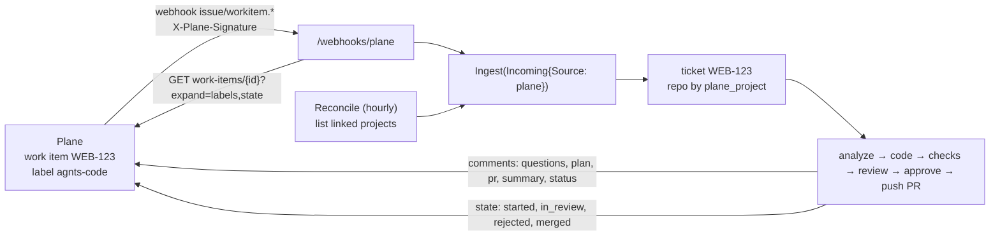

# agnts × Plane — Plan

Oct 7, 2026 · draft

## Overview

Work enters agnts from Jira or by hand. Teams on [Plane](https://github.com/makeplane/plane) (open source, often self-hosted) have no way in. This plan adds **Plane as a second tracker, at parity with Jira**: label a work item `agnts`, and agnts analyses it, asks questions on the work item, codes it, waits for your approval, opens the pull request, comments the link and summary back, and moves the work item through your states up to merged.

**Goals**

- Same flow as Jira, end to end: pickup by label (`agnts`, `agnts-<kind>`), comments by kind, state moves on the four milestones, blocking relations into the queue, follow-ups filed as new Plane work items, reports posted on request.
- Works on Plane Cloud and on self-hosted Community Edition (the common case), with nothing that needs a paid Plane plan.
- Jira and Plane can be connected at the same time; each repository says which project of which tracker feeds it.
- Fits Plane's 60 requests/minute API limit with room to spare.

**Out of scope for v1:** OAuth / "Plane App" install flow (v1 uses a personal API key), cycles and modules, syncing assignees, attachments, mirroring agnts questions as Plane sub-items, and bidirectional comment sync (agnts answers stay in agnts).

**Principles**

1. **Copy the Jira adapter's shape.** `tracker/plane` has the same three parts as `tracker/jira`: a client that implements `Tracker` and `IssueCreator`, a webhook handler, and a reconcile loop. The orchestrator learns nothing Plane-specific.
2. **Generalise once, not twice.** Today the orchestrator has one `tracker` and checks `Source == SourceJira` everywhere. That becomes "the tracker for this ticket's source". After this, a third tracker (Linear, GitHub Issues) is only an adapter.
3. **Keys are the human ones.** Plane work items are `WEB-123` (project identifier + `sequence_id`), the same shape as Jira keys, so tickets, branches (`agnts/WEB-123`) and PR titles look the same. UUIDs stay inside the adapter.
4. **The webhook is a nudge; the API is the truth.** Payloads differ between Plane versions (v1 on Community Edition, v2 on Cloud) and carry label and state UUIDs. The handler verifies, dedupes, reads the work item key or id, then fetches the work item with `expand=labels,state,project`. A single fetch per delivery keeps us far under the rate limit.

## How it works



### Connection

Integrations → **Plane** asks for:

| Field | Example | Notes |
| --- | --- | --- |
| Base URL | `https://api.plane.so` or `https://plane.acme.dev` | Self-hosted: the instance URL. The adapter appends `/api/v1`. |
| Workspace slug | `acme` | From the Plane URL. Every API path is scoped by it. |
| API key | `plane_api_…` | Profile → Personal Access Tokens. Sent as `X-API-Key`. Stored encrypted (same `SecretsToken` JSON as Jira). |
| Webhook secret | from Plane | **Unlike Jira, Plane generates the secret** (Workspace settings → Webhooks, downloaded once as CSV). The page shows the URL `https://<agnts>/webhooks/plane` to paste into Plane, and a field for the secret Plane gave back. |

The check calls `GET /api/v1/users/me/` and then `GET /api/v1/workspaces/{slug}/projects/` (proves the key can see the workspace). The account shown is the user's display name.

Settings (non-secret, like Jira's): `label` (default `agnts`), `status_started`, `status_in_review`, `status_rejected`, `status_merged`, `comment_*` toggles. Priorities map by a fixed table (see Intake).

### Repositories

A repository gets a **Plane project** field next to the Jira one: the project identifier (`WEB`). Validation:

- letters/digits only, uppercased; unique across `plane_project`, `jira_project` and every repository's task prefix, since all three number tickets `KEY-n` in the same key space;
- a repository may have a Jira project, a Plane project, both, or neither (`kind` becomes informative only; see Data).

### Intake

1. **Webhook** `/webhooks/plane`, POST only.
   - 503 when not connected or no secret (refuse unsigned deliveries, as Jira does).
   - Read the body (2 MB cap), verify `X-Plane-Signature` = hex HMAC-SHA256(secret, raw body) with `hmac.Equal`, 401 on mismatch.
   - Dedupe on `X-Plane-Delivery` through the existing `SeenDelivery(ctx, "plane", id)`.
   - Accept both formats: v2 (`"version":"v2"`, `event` `workitem.created|updated`) and v1 (`event: "issue"`, `action: create|update`). Ignore deletes, other entities and comment events in v1.
   - Get the work item id from `data.id` (and project id from `data.project`), fetch it with `expand=labels,state,project`, and drop it (204) if it has none of the agnts labels or its state group is `completed`/`cancelled` and agnts does not know it.
   - **Always 2xx on things we ignore.** Plane disables a webhook after 5 failed deliveries, so only a real store error returns 500.
2. **Reconcile** every `AGNTS_PLANE_SYNC_EVERY` (default 1h): for each repository with a Plane project, resolve the project id, page through `GET /projects/{pid}/work-items/?expand=labels,state&per_page=100` and ingest the ones with an agnts label whose state group is not completed/cancelled. Also `POST /integrations/plane/sync` and a Sync button, like Jira.
3. **Mapping into `orchestrator.Incoming`**:

| Plane | Incoming |
| --- | --- |
| `project.identifier` + `-` + `sequence_id` | `Key`, `Project` |
| `name` | `Title` |
| `description_html` → text | `Description` (small HTML-to-text: paragraphs, lists, `<pre><code>` to fences, links as `text (url)`) |
| `priority` `urgent`/`high` → `high`, `medium` → `medium`, `low` → `low`, `none` → "" | `Priority` |
| label `agnts-<kind>` | `Kind` |
| relations `blocked_by` / `blocking` | `DependsOn` / `Dependents`, `LinksKnown = true` (only when the relations call succeeded) |

Relations come from `GET /work-items/{id}/relations/`, which returns related work item ids grouped by type. They need translating to keys (one lookup each, cached). **To verify against a running instance:** the exact response shape and whether Community Edition exposes it under `/api/v1`. If not, `LinksKnown` stays false and nothing is removed.

### Write-back (`Tracker` and `IssueCreator`)

| Call | Plane API |
| --- | --- |
| resolve `WEB-123` | `GET /workspaces/{slug}/work-items/WEB-123/` gives `id` and `project`; cached (key → ids) in memory, never expires (ids are stable) |
| `Comment` | `POST /projects/{pid}/work-items/{id}/comments/` with `comment_html` (text escaped, one `<p>` per line, URLs linked). Same per-kind toggles as Jira. |
| `MoveTo(status)` | Load the project's states (`GET /projects/{pid}/states/`, cached 10 min). If the setting names a state, match by name (case-insensitive). If it is empty, fall back by **group**: `started` → first state in group `started`; `merged` → first in `completed`; `rejected` → first in `cancelled`; `in_review` → none (Plane has no review group; users name a state such as "In Review"). Then `PATCH /work-items/{id}/` with `{"state": "<uuid>"}`. |
| `CreateIssue` | `POST /projects/{pid}/work-items/` with `name`, `description_html`, `priority`; returns the new key from `project identifier + sequence_id`. Set `external_source: "agnts"` and `external_id: <parent key>/<suggestion id>` so a retried create can be found instead of duplicated. |
| `LabelIssue(kind)` | Find label `agnts-<kind>` in the project (`GET /projects/{pid}/labels/`), create it if missing (`POST`), then `PATCH` the work item's `labels` to existing + new. |
| `LinkIssues` | `POST /work-items/{id}/relations/` with `relates_to` (verify payload shape). |

Unlike Jira, a Plane state change needs no transition lookup: any state can be set directly.

### Rate limit

60 req/min per key. Usage per ticket is roughly: 1 fetch per webhook, ~5 comments and 4 state moves over its life, plus cached lookups. The reconcile is the only bulk caller (1 request per 100 work items per project). The client honours `429` and `X-RateLimit-Reset`, backs off, and retries once; the reconcile paces itself to ≤ 30 req/min so interactive calls keep headroom.

## Changes by layer

### 1. Orchestrator: trackers by source

- `domain.SourcePlane TicketSource = "plane"`; `domain.RelFromPlane` (or rename to `RelFromTracker` — see Open questions).
- `Incoming` gets `Source domain.TicketSource`. `Ingest` uses it instead of hardcoding `SourceJira`, picks the repository with `RepositoryByTrackerProject(ctx, source, project)`, and writes "ticket text updated in Plane".
- `Deps.Tracker Tracker` becomes `Deps.Trackers map[domain.TicketSource]Tracker`. `trackerComment`, `trackerMove` and `deliver` look up `o.trackers[t.Source]`; a missing entry is the same as today's nil tracker.
- `syncJiraRelations` → `syncTrackerRelations`, with the source on each relation; the store method `SyncJiraRelations` → `SyncTrackerRelations(ctx, source, key, rs)`, which only replaces relations of that source.
- Follow-ups: target `plane` beside `local` and `jira`. `acceptToJira` → `acceptToTracker(source)`, taking the project from the parent key or `repo.PlaneProject`.
- `mcpserver`: `post_report` checks "has a tracker issue" instead of `SourceJira`; the follow-up `target` enum gains `plane`.

All existing Jira tests should pass unchanged except for renamed calls; this step ships on its own before any Plane code.

### 2. `server/internal/tracker/plane`

```
plane.go       Config, FromIntegration, SecretsToken, SettingKeys, Client (call, resolve, caches)
tracker.go     Comment, MoveTo, CreateIssue, LabelIssue, LinkIssues
webhook.go     WebhookHandler, validSignature, v1/v2 payload parsing, Reconcile
html.go        description_html → text, text → comment_html
plane_test.go  httptest server fixtures for both webhook versions, state fallback, 429 handling
```

### 3. Data (migration `00020_plane.sql`)

```sql
ALTER TABLE repositories ADD COLUMN plane_project text NOT NULL DEFAULT '';
CREATE UNIQUE INDEX repositories_plane_project_idx ON repositories (plane_project) WHERE plane_project <> '';
-- widen CHECKs: tickets.source, integrations.provider, ticket_relations.source, repositories.kind
ALTER TABLE tickets DROP CONSTRAINT tickets_source_check,
  ADD CONSTRAINT tickets_source_check CHECK (source IN ('jira', 'plane', 'local'));
-- same pattern for integrations_provider_check (+ 'plane'),
-- ticket_relations_source_check (+ 'plane'), repositories_kind_check (+ 'plane')
```

Check the real constraint names in `\d` first (they are auto-named). Down migration reverses it.

### 4. Admin, API, CLI

- `admin.Providers` + `settingKeys["plane"]`, `PlaneCheck`, Plane branch in `view()` (webhook URL; no generated secret) and `Connect()` (secret comes from the form).
- `SyncPlane` + `POST /integrations/plane/sync`.
- OpenAPI: `plane` in the provider, `TicketSource`, `RelationSource` and follow-up target enums; `planeProject` on Repository and its input. `make gen`.
- `cmd/agnts`: wire `plane.New`, the webhook route, `plane.Reconcile`, the `Trackers` map; `AGNTS_PLANE_SYNC_EVERY` in `config`; `agnts integration set plane` and `repo add --plane WEB`.

### 5. Admin panel and mobile

- `providers.ts` (colour, icon), `ConnectForm.vue` (base URL, workspace slug, API key, webhook secret, with a link to Plane's token page), `PlaneSettings.vue` (label, the four states as a dropdown loaded from the first linked project, comment toggles).
- `RepoDrawer.vue`: Plane project field. `TicketBoard.vue`: source badge. `FollowUps.vue`: "New Plane work item" target. Sync button: one per connected tracker (or a single "Sync trackers").
- `shared/i18n` EN/RU/UZ strings. Mobile: source badge only.

## Delivery

| Step | What | Size |
| --- | --- | --- |
| 1 | Orchestrator refactor to trackers by source (no behaviour change, Jira tests green) | S–M |
| 2 | Migration, domain constants, OpenAPI + gen | S |
| 3 | `tracker/plane` client, write-back, HTML conversion, tests against fixtures | M |
| 4 | Webhook (v1 + v2), reconcile, wiring in `serve.go`, CLI | M |
| 5 | Admin connect/settings, repo field, follow-up target, i18n | M |
| 6 | Test on Plane Cloud **and** self-hosted Community Edition (`docker compose` from makeplane/plane): pickup, questions, approve, merge, reject, follow-up, relations, missed webhook caught by reconcile | S |

## Open questions

1. **Relation source naming.** Add `plane` next to `jira`, or replace both with `tracker` plus the ticket's source? Separate values keep existing rows and the UI label ("from Jira links") unchanged; this plan assumes separate values.
2. **Pickup without labels.** Plane teams often use a state (e.g. "Ready for agnts") instead of labels. Worth a setting `pickup: label | state` in v1, or wait for demand?
3. **OAuth app.** A personal key acts as one person (comments show their name). A Plane App gives a bot identity but needs a public install flow and, on self-hosted, may need a paid plan. Defer to v2 unless comments as a person are a problem.
4. **Verify on a live instance before step 3:** the relations endpoint shape, whether Community Edition still sends only v1 webhooks, and whether `expand=labels` is honoured on the by-key route.
