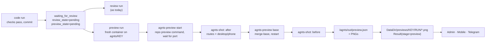

# agnts Visual Preview — Plan

Oct 7, 2026 · draft

## Overview

For frontend tickets the reviewer gets a diff, the check results and the code review, but never sees the change running. agnts pushes nothing before approval, so the only way to look at it is to approve first and check out the branch afterwards. That is backwards: a misaligned button or a blank page is exactly what a person should catch **before** approving.

This plan adds a **preview run**: a side run, like the code review, that starts the app in a container, opens the pages the change touches in a headless browser, and stores **before / after screenshots** at desktop and phone width, plus console errors and the visual problems Claude noticed. The reviewer sees them on the ticket in the admin panel, the mobile app and Telegram, and can point at a screenshot when requesting changes.

```
Ticket PAY-142 · waiting for review
[Changes] [Review 3] [Preview 6] [Follow-ups]

/tickets/:key  ·  Desktop | Phone  ·  Before | After | Side by side
┌──────────────┐ ┌──────────────┐
│   before     │ │    after     │   ⚠ 1 issue: "Save" button overlaps the
│              │ │              │     tab bar at 390px (phone, after)
└──────────────┘ └──────────────┘   2 console errors on /tickets/:key
```

**Goals**

- A reviewer of a UI ticket sees what changed without leaving the ticket, on a phone too.
- No new infrastructure: the same runner image, network, egress proxy and worker slot as every other run. Runs on the 2 GB VPS from the README.
- Advice, never a gate, exactly like the code review: approving or requesting changes cancels a preview still running; every new revision gets a new one.
- Everything is set up per repository in the admin panel; repositories without a preview command behave as today.

**Out of scope for v1:** a live, clickable preview URL (phase 2, see the end), Flutter/native mobile apps (the runner image has no Flutter SDK), pixel-diff regression testing, pushing to Vercel/Netlify before approval.

**Principles**

1. Copy the code review. The preview is a side stage with a `PreviewState` on the ticket, queued, claimed, cancelled and recovered the same way. Most of the code has a twin in `review.go`.
2. Claude picks the pages, the runner takes the screenshots. Claude reads the diff and decides which routes and states to open; a fixed script (`agnts-shot`) does the browser work, so screenshots are consistent and cheap.
3. Screenshots are disposable. They live on disk under `DataDir`, not in PostgreSQL, so they never bloat the nightly dump; a re-run makes new ones.
4. Nothing leaves the sandbox. The app runs on `localhost` inside the run container; the browser reaches it there (`NO_PROXY` already covers localhost). Only hosts on the egress allowlist are reachable.

## How it works



### The preview run, step by step

1. `ClaimNext` picks a ticket in `waiting_for_review` with `preview_state = 'pending'` (after main stages and code reviews, before learn runs) and opens a run with stage `preview`.
2. `openWorkspace` starts a container on `t.Branch`, the commit under review. agnts writes into it:
   - `/agnts/in/change.diff`: the reviewed change (`changeDiff(res.Files)`, as the review does)
   - `/agnts/in/preview.json`: the repository's preview settings (command, port, ready path, pinned routes, login notes, whether to compare with the base)
   - `/agnts/in/preview.env`: the repository's preview environment, decrypted; it is never logged or echoed in events
3. Claude runs with the `preview` prompt, **read-only** permissions (`permissionSettings(s, true)`), `previewMaxTurns = 40` and a `previewTimeoutMin = 20`, and the `preview` model (Sonnet by default). The prompt tells it to:
   - start the app with `agnts-preview start`, which runs the command in the background with the env file loaded, waits for `localhost:<port><readyPath>` (up to 5 min) and logs to `/tmp/preview.log`
   - read the diff and choose up to 8 routes and states (a modal open, a tab selected, an empty list) that show the change, plus any pinned routes
   - capture each with `agnts-shot` at desktop (1440×900) and phone (390×844) width, after state
   - look at its own screenshots (Claude reads PNGs) and note real visual problems: overlap, overflow, cut-off text, a blank page, an unstyled component
   - if comparison is on, run `agnts-preview base` (checks out the merge-base with the default branch, restarts the app) and capture the same routes as before state; a route that does not exist on the base is "new"
   - write `/agnts/out/preview.json`
4. agnts reads the manifest, checks it (see *Security*), copies each PNG out of the container (`ws.ReadFile`), stores them, saves a `Result` whose `Summary` is the `domain.Preview` JSON, sets `preview_state = 'done'` if the ticket is still on that revision, and appends an `EventPreview` that the notifier announces.

### Manifest Claude writes

```json
{
  "summary": "The ticket page gets a Preview tab; the tab bar wraps on phones.",
  "status": "ok",
  "shots": [
    { "id": "ticket-tabs-desktop-after", "file": "shots/ticket-tabs-desktop-after.png",
      "name": "Ticket page, Preview tab", "route": "/tickets/PAY-1", "viewport": "desktop", "side": "after",
      "note": "Preview tab selected", "consoleErrors": 0 }
  ],
  "issues": [
    { "severity": "medium", "description": "Tab bar wraps to two lines at 390px; Follow-ups is pushed under the header.",
      "shotId": "ticket-tabs-phone-after" }
  ]
}
```

`status` is `ok`, `partial` (some routes failed: login wall, crash) or `failed` (the app never started, with the tail of `/tmp/preview.log` as the summary). A failed app start is a result the reviewer should see, not a run error: it often means the change broke the dev server.

### When a ticket gets a preview

`previewState(s, repo, files)` at the end of `code()`, next to `reviewState(s)`:

- `Settings.AutoPreview` is on, **and**
- the repository has a preview command, **and**
- at least one changed file matches the repository's UI paths (globs such as `src/**/*.{vue,tsx,jsx,css,scss}`); empty UI paths mean every change.

Otherwise `preview_state` stays empty and the ticket page offers **Run preview** (`POST /tickets/{key}/preview`) whenever the repository has a preview command. Report kinds (plan, analysis, bug) never get one.

## Repository settings

New fields on `domain.Repository`, edited in a **Preview** section of the repository page:

| Field | Example | Notes |
| --- | --- | --- |
| `PreviewCmd` | `npm ci && npm run dev -- --host 127.0.0.1 --port 4173` | Empty turns previews off for the repo |
| `PreviewPort` | `4173` | |
| `PreviewReadyPath` | `/` | Polled until it answers below 500 |
| `PreviewRoutes` | `/`, `/tickets` | Always captured, besides what Claude picks |
| `PreviewUIPaths` | `src/**/*.vue`, `src/**/*.css` | When a change counts as a UI change |
| `PreviewLogin` | "Sign in as demo@acme.test, password in `PREVIEW_PASSWORD`" | Free text for Claude |
| `PreviewEnv` | `VITE_API_URL=https://staging.acme.com` | Encrypted with `AGNTS_ENC_KEY`, write-only in the API |
| `PreviewCompare` | `true` | Before shots from the merge-base; doubles the run time |

**Data.** A page with no backend renders empty, and that is the biggest risk to the feature's usefulness. Each repository chooses one of: point the env at a staging API, use the app's own mock mode (`VITE_USE_MOCKS=1`), or start a backend in the preview command (`docker compose` is not available in the container, so this only works for single-process stacks). The admin form says this plainly, and the repository page warns when previews keep coming back `partial`.

**Egress.** A staging host must be on the egress allowlist. Today that list is `AGNTS_EGRESS_ALLOW` at startup. Add **Settings → Network → Extra allowed hosts**, stored in settings and read by `egress.Proxy` through an `AllowSource` that is re-read every minute, so adding a staging host needs no restart. The list stays global (per-repository rules would need the proxy to know which container is calling; not worth it for v1).

## Changes by package

### Runner image (`deploy/runner/`)

- As root, before `USER agent`: install Playwright and Chromium with its system libraries into `/opt/playwright` (`PLAYWRIGHT_BROWSERS_PATH=/opt/playwright`). That adds about 400 MB to the image. Pin the Playwright version the same way Claude Code is pinned.
- `/usr/local/bin/agnts-shot` (Node, uses Playwright): `agnts-shot <url> --viewport desktop|phone --out <file> [--full-page] [--wait <selector>] [--click <selector>]...`. Launches Chromium with `--no-sandbox --disable-dev-shm-usage` (the container drops every capability and has a 64 MB `/dev/shm`), disables animations and the caret, waits for network idle, writes the PNG (full page capped at 4000 px tall) and prints JSON with console errors and failed requests. Keeps one browser alive across calls through a small daemon on a Unix socket, so 16 shots do not pay 16 browser starts.
- `/usr/local/bin/agnts-preview`: `start | stop | logs | base`. `base` runs `git checkout --detach $(git merge-base HEAD origin/<default>)` and restarts; it reinstalls dependencies only when the command does (it is the same command).
- `managed-settings.json` keeps denying `curl` and `wget`; `agnts-shot` only takes `http://localhost` and `http://127.0.0.1` URLs, so it cannot be used to reach the network.
- Check that `gitrepo.Archive` includes the default branch's ref in `.git` so `merge-base` works inside the container; add it if it doesn't.

### Domain (`server/internal/domain/`)

- `ticket.go`: `StagePreview Stage = "preview"`; `Side()` includes it. `Ticket.PreviewState` with the same values as `ReviewState` (`""`, `pending`, `running`, `done`, `failed`).
- `settings.go`: `ModelPreview = "preview"`, `StageModels.Preview` (default `sonnet`), `Settings.AutoPreview` (default `true`; it only matters for repos with a preview command), `Settings.EgressAllow []string`.
- New `preview.go`: `Preview{Revision, Model, Summary, Status, Shots, Issues, CreatedAt}`, `Shot{ID, Name, Route, Viewport, Side, Width, Height, Note, ConsoleErrors}`, `PreviewIssue{Severity, Description, ShotID}`, and `Normalize()` like `Review.Normalize`: trims text, drops shots with bad ids or viewports, caps counts, and keeps only issues whose `ShotID` exists (or is empty). Severities reuse `FindingSeverities`.
- `Repository`: the fields in the table above.
- `EventPreview = "preview"`.

### Migration `server/migrations/00019_previews.sql`

```sql
ALTER TABLE repositories
  ADD COLUMN preview_cmd        text    NOT NULL DEFAULT '',
  ADD COLUMN preview_port       integer NOT NULL DEFAULT 0,
  ADD COLUMN preview_ready_path text    NOT NULL DEFAULT '/',
  ADD COLUMN preview_routes     text[]  NOT NULL DEFAULT '{}',
  ADD COLUMN preview_ui_paths   text[]  NOT NULL DEFAULT '{}',
  ADD COLUMN preview_login      text    NOT NULL DEFAULT '',
  ADD COLUMN preview_env        bytea,              -- sealed with AGNTS_ENC_KEY
  ADD COLUMN preview_compare    boolean NOT NULL DEFAULT true;
ALTER TABLE tickets ADD COLUMN preview_state text NOT NULL DEFAULT '';
```

There are no CHECK constraints on `runs.stage` or `claude_calls.model_stage`, so the new values need no constraint changes.

### Store (`server/internal/store/postgres/`)

- `tickets.go` `ClaimNext`: a fourth query after code reviews and before learn runs: `state = 'waiting_for_review' AND preview_state = 'pending'`, no open run, `ORDER BY updated_at`; the run's stage is `preview`, and `preview_state` becomes `running` in the same transaction (as `review_state` does). `ticketCols` and `scanTicket` gain `preview_state`.
- `RecoverInterrupted`: a `running` preview goes back to `pending`, as reviews do.
- Repository read/write for the new columns; `preview_env` is sealed and opened with the existing secret box and never returned by list queries.

### Screenshot storage (new port)

```go
// Shots stores preview screenshots on disk, by ticket and run.
type Shots interface {
	Save(ticketKey string, runID int64, id string, png []byte) error
	Open(ticketKey string, runID int64, id string) (io.ReadCloser, error)
	// Prune keeps the shots of the given runs and deletes the rest of the ticket's.
	Prune(ticketKey string, keep []int64) error
}
```

Implemented in `gitrepo` next to `Homes` (`gitrepo.NewShots(filepath.Join(cfg.DataDir, "previews"))`), wired in `cmd/agnts/serve.go`. Layout: `previews/<KEY>/<runID>/<id>.png`. Retention: after a preview is saved, keep the newest two preview runs of the ticket; when a ticket reaches `done` or `rejected`, delete its shots 30 days later (a sweep in the `AutoResume` minute tick). The data dir is not in the nightly `pg_dump`, which is fine: screenshots can be regenerated.

### Orchestrator (`server/internal/orchestrator/`)

New `preview.go`, mirroring `review.go`:

- constants `previewMaxTurns = 40`, `previewTimeoutMin = 20`, `previewMaxShots = 24`, `previewMaxShotBytes = 3 << 20`
- `previewState(s, repo, files) string` and `touchesUI(files, globs) bool` (`path.Match` per segment, with `**` support)
- `dropPreview(x *domain.Ticket) bool`, called next to every `dropReview` in `actions.go` (approve, request changes, reject), so leaving review cancels a running preview the same way
- `(o *Orchestrator) Preview(ctx, key, origin)` queues one (manual **Run preview**)
- `(o *Orchestrator) preview(ctx, s, t, run)` is the run described above; rate limits requeue it (`stopError`, `preview_state` back to `pending`) as in `review`
- `parsePreview(raw) (domain.Preview, error)` and `previewFailed`, `setPreviewState`, `latestPreview`

Elsewhere:

- `orchestrator.go`: `work()` dispatches `StagePreview`, and failures go to `previewFailed` like review failures; `code()` sets `x.PreviewState = previewState(s, repo, files)` in the final transition; `claude()` passes `readOnly` for `StagePreview` too.
- `prompts.go`: a `preview` template that takes the ticket, the work summary, the changed files, the analysis plan, the repository's preview settings and the team rules.
- `Deps`/`Orchestrator` gain `Shots`.

### Egress (`server/internal/egress/`)

`Proxy` takes an `AllowSource func() []string` merged with the static list and cached for a minute, so hosts added in Settings take effect without a restart. Tests cover the merged list and that IP literals are still refused.

### API (`shared/openapi/openapi.yaml`, then `make gen`)

- `Repository` / `RepositoryInput`: a `preview` object with the fields above. `env` is write-only, and responses carry only `envSet: boolean` and the variable **names**.
- `Ticket.previewState` (enum like `reviewState`).
- `TicketDetail.preview: TicketPreview` with `revision`, `model`, `summary`, `status`, `shots[]`, `issues[]`, `createdAt`. Each shot carries a `url` built by the server, so clients never build paths.
- `POST /tickets/{key}/preview` → `reviewTicket`'s twin, `previewTicket`.
- `GET /tickets/{key}/preview/{runId}/shots/{shotId}` → `image/png`. It works with the session cookie (admin ``) and with Bearer (mobile). It sends `Cache-Control: private, max-age=31536000, immutable` because a run's shots never change, and returns 404 unless the run belongs to the ticket.
- `Settings`: `autoPreview`, `models.preview`, `egressAllow[]`. Add `preview` to the model-stage enums (`[analyze, coding, retry, helper, learn, review]`).
- `httpapi/tickets.go`: build `preview` in the detail response from `latestPreview`; the shot handler streams from `Shots.Open` after checking the shot id against the stored manifest (no client-supplied path ever reaches the filesystem).

### Admin panel (`apps/admin/`)

- `components/ticket/PreviewShots.vue`: a **Preview** tab beside **Review** in `TicketPage.vue`'s `tabs` (count = issues on this revision, as Review counts findings). Routes as rows; controls for Desktop / Phone and Before / After / Side by side; a drag slider in side-by-side; click to zoom. Issues listed above the gallery, each jumping to its shot. Console errors per shot as a small badge. A header line like "Revision 2 · Sonnet · 6 screenshots", or "Older revision, run again" when stale. A **Run again** button.
- **Add to feedback** on each shot and issue, like the review's one-click suggestions: it adds "On *Ticket page, phone, after*: …" to the request-changes text and records the shot reference (see phase 1c).
- Repository page: a **Preview** section with the fields, a UI-paths helper with presets per stack (Vue/Vite, React/Next, Angular), and a **Try preview** button that queues a preview run on the default branch, so a setup mistake shows up before any ticket depends on it. That run is a ticketless side run; if that is too much for v1, skip it and let the first ticket be the test.
- Settings: an **Auto preview** toggle, the preview model, and the extra allowed hosts.
- i18n: `shared/i18n/{en,ru,uz}/ticket.json`, `repos.json` and `settings.json` keys for everything above.

### Mobile (`apps/mobile/`)

- `features/tickets/preview_shots.dart`: a section on `ticket_screen.dart` under the code review, with a horizontal pager per route and a Before/After toggle. Phone-width shots are the default here. Images load with `Image.network(url, headers: {'Authorization': 'Bearer …'})` through the existing session.
- Regenerate `agnts_api`; add the strings to `app_en.arb`, `app_ru.arb` and `app_uz.arb`.

### Notifications (`server/internal/notify/`)

- `EventPreview` is handled like `EventReview`: a push notification and a Telegram message, "Preview ready for PAY-142: 6 screenshots, 1 issue", linking to the ticket.
- Telegram, behind a toggle: `sendMediaGroup` with up to four phone-width after shots. The bot uploads the bytes; screenshots are never made public by URL.

### MCP (`server/internal/mcpserver/`)

`get_ticket` includes the preview summary, status and issues (not the images), so Claude chat can answer "did the preview find anything?".

## Phases

**1a — MVP (admin only).** Runner image and scripts, repository settings, migration, `StagePreview` end to end, the shots store, the API, and the admin Preview tab. Done when a Vue ticket on this repo (`apps/admin`) gets before/after shots on its ticket page without anyone touching it.

**1b — Everywhere the reviewer is.** Mobile section, push and Telegram, MCP summary, egress hosts in Settings, retention sweep.

**1c — Closing the loop.**
- *Screenshots in feedback:* shots referenced from "request changes" are copied into the next code run's container at `/agnts/in/feedback/<id>.png`, and the feedback prompt lists them, so Claude sees exactly what the reviewer pointed at.
- *Visual self-check while coding:* for repos with a preview command, the `code` prompt tells Claude it may start the app and use `agnts-shot` to look at the pages it changed before finishing. It costs turns, so it gets its own setting (default on for repos with UI paths) and a hard cap of about 10 turns spent on it, stated in the prompt.

## Testing

- `domain`: `Preview.Normalize` (bad ids, unknown viewport, issues pointing at missing shots, caps).
- `orchestrator/preview_test.go` with the fake workspace from `orchestrator_test.go`:
  - queued at the end of `code()` only when the repo has a command and the files match the UI paths
  - not queued for report kinds
  - dropped on approve, request changes and reject
  - a stale revision never marks the ticket `done`
  - rate limits requeue it
  - a manifest with `../` in a file path or a shot over the size cap is rejected
  - `status: failed` from the app is saved as a result, not treated as a run error
- `store/postgres`: `ClaimNext` order (main stages > reviews > previews > learn), `RecoverInterrupted` requeues previews.
- `httpapi`: the shot endpoint with a cookie, with Bearer, without auth (401), a shot of another ticket (404), an unknown shot id (404).
- `egress`: dynamic allowlist.
- Runner smoke test (`make runner-smoke`, also in CI): build the image, start a container like the runner does (read-only root, all capabilities dropped, internal network), serve a tiny static page from `server/internal/runner/testdata/preview/`, and assert `agnts-shot` writes a PNG with the right width.
- Admin: `PreviewShots.test.ts` (stale revision, issue → shot jump, add to feedback).

## Security

- The app under preview is unapproved code. It runs only inside the existing hardened run container: read-only root, all capabilities dropped, PID and memory limits, internal network with the egress proxy as its only way out. No port is published.
- The preview env is visible to Claude and to the app inside the container, the same trust level as the repository's code. The admin form says to use **staging-only** credentials. Values are sealed at rest, never returned by the API, never written to events or logs, and the prompt tells Claude not to print them.
- Screenshots can contain staging data. They are served only to signed-in users and cached privately, and they are deleted with the retention rules.
- agnts reads only files listed in the manifest, under `/agnts/out/shots/`, with ids matching `^[a-z0-9-]{1,64}$`, at most `previewMaxShots` files of at most `previewMaxShotBytes` each, and checks the PNG signature before storing.
- `agnts-shot` refuses anything but `localhost` and `127.0.0.1` URLs.

## Costs and limits

- **Time.** About 2–6 minutes per preview (install, start, 8–16 shots), doubled with comparison on. It uses the worker slot only after main stages and code reviews, so it never delays coding on another ticket.
- **Plan usage.** One Sonnet session of at most 40 turns per revision. It is shown in the ticket's spend card under its own stage, as review is.
- **Disk.** About 150–400 KB per PNG, so roughly 5 MB per ticket at two kept revisions.
- **Image.** About +400 MB for Chromium.

## Open questions

1. Should comparison (before shots) default on? It is the most useful view, but it doubles the run time.
2. Should agnts provide a seeded login for apps behind authentication, or is free-text login instructions plus env good enough for v1?
3. Does **Try preview** on the repository page (a ticketless run) belong in 1a, or can the first ticket serve as the test?

## Phase 2 (later): live preview

A **Open preview** button that keeps a container running from the ticket's commit with the same preview command, served at `https://<key>.preview.<domain>` by Caddy with on-demand TLS (an `ask` endpoint on agnts allows only tickets with an open preview) and `forward_auth` against the agnts session. It stops after 30 minutes idle, with at most 1–2 at once. It reuses everything from phase 1 (repository preview settings, env, egress hosts, `agnts-preview`), so phase 1 is not throwaway work.
