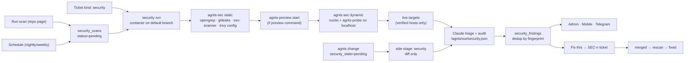

# agnts Security Testing — Plan

Oct 14, 2026 · draft · builds on `Preview plan.md` and `CI plan.md`

## Overview

agnts writes code, reviews it and shows it running, but nobody asks the question a breach answers too late: **what in this application can be attacked, and how do I close it?** Today the code review has one security pass over the diff and nothing else. There's no dependency audit, no secret scan, no look at the running app, and no view of the repository as a whole.

This plan adds **security testing**. agnts scans a repository's code, dependencies and secrets, starts the app in the sandbox and probes it on `localhost`, and, for domains the user proves they own, scans the live site. Every weakness becomes a **finding** with its severity, evidence, why it matters and how to fix it. **Fix this** turns a finding into an ordinary agnts ticket that goes through the usual flow: analysis, code, checks, review and your approval. Once the fix merges, the next scan confirms the finding is gone.

```
Security · api                                   last scan 2h ago · nightly · ▲ 1 new
┌─────────────────────────────────────────────────────────────────────────────────────┐
│ ● critical  SQL injection in /orders search        handlers/orders.go:88   → SEC-12 │
│             confirmed on the running app: ' OR 1=1 -- returns every order           │
│ ● high      lodash 4.17.20 · prototype pollution   package-lock.json   CVE-2021-23337│
│             reachable: _.merge used in api/merge.ts:14            [Fix this]        │
│ ● high      AWS key committed                      config/dev.yml:3  (rotate first!) │
│ ● medium    Session cookie without Secure/HttpOnly https://staging.acme.com  [Fix]  │
│ ○ low       Missing Content-Security-Policy        all pages          dismissed: WIP │
└─────────────────────────────────────────────────────────────────────────────────────┘
```

**Goals**

- A user gets a prioritized list of real weaknesses in their app, each with a concrete fix, in one click from a repository page, without installing or configuring a scanner.
- Every fix is a normal agnts ticket, so it gets the same approval guarantees as every other change. Nothing is pushed before approval.
- Findings have an identity that survives across scans: new, still open, fixed or dismissed. A nightly scan alerts on **what changed**, not on the same 40 items every night.
- agnts's own changes get a cheap security check before you approve them, as a side stage next to review and preview.
- Live scanning never touches a host the user hasn't proved they control, and it is rate-limited and non-destructive by default.

**Out of scope for v1:** authenticated scanning of live sites (login flows on production), mobile binaries (APK/IPA), cloud account posture (AWS/GCP configuration), container image scanning of registries, penetration-style exploitation chains, compliance reports (SOC 2, PCI), and rewriting git history to purge leaked secrets.

**Principles**

1. **Tools find, Claude judges.** Pinned open-source scanners do the wide, cheap sweep. Claude removes false positives using the code around each hit, checks whether a vulnerable dependency is actually reachable, looks for what scanners miss (broken authorization, IDOR, business logic), and writes the fix. A scan with no tool hits on a diff costs no Claude turns.
2. **Copy what exists.** Repository scans are ticketless repo-level jobs, like briefs. The change scan is a side stage, like preview. Fix tickets come from findings, like CI failures. The running app uses the preview configuration as it is.
3. **A finding is not a scan result.** Findings are deduplicated by fingerprint across scans, like CI failure groups. One finding has many sightings and at most one fix ticket.
4. **Scope is enforced by agnts, not by the prompt.** Claude can't use `curl`. It probes through agnts scripts that refuse any target outside `localhost` and the scan's verified hosts, and the egress proxy allows a live host only to the container scanning it.
5. **Never store a secret we found.** Secret findings keep a masked value and a hash, never the value itself.

## How it works



### The four ways a scan starts

| Trigger | What it scans | Where it lives | Claude |
| --- | --- | --- | --- |
| **Run scan** on a repository | Whole repo at the default branch, the app on localhost when it has a preview command, and verified live targets when ticked | `security_scans` row, ticketless repo job (`ClassSecurity`) | Always (Sonnet, up to 60 turns) |
| **Schedule** per repository (off / daily / weekly) | Same as Run scan; skipped when the default branch commit and the vulnerability databases haven't changed since the last scan | Same | Always, but notifies only on new or reopened findings |
| **Side stage** on an agnts change | Changed files, changed lockfiles and new secrets in the diff. The app is probed only when the change touches routes or middleware (globs) | `Ticket.SecurityState`, `StageSecurity` | Only when a tool reports something, to triage and suggest a fix |
| **Ticket kind `security`** | What the ticket asks for ("audit the payment flow", "is our file upload safe?"), with all tools available | Ordinary ticket, report output, `Implementable` | Always; the report's findings are also saved as findings |

### A repository scan, step by step

1. The orchestrator's minute tick enqueues due schedules (`repositories.security_next_at <= now()`). **Run scan** inserts a `pending` scan directly. `ClaimSecurityScan` picks the oldest pending scan in the `security` queue class (after review/preview, before learn), so it never delays coding.
2. `runSecurityScan` opens a container like `runSurvey` does (`runner.Open(WorkspaceSpec{TicketKey: "sec-<id>"})`) on the default branch. It mounts the vulnerability-database volume `/opt/secdb` read-only (see *Vulnerability data*) and writes:
   - `/agnts/in/security.json`: the scope (static, app, live targets), the repository's exclusions, known dismissed fingerprints, and the rate limits
   - `/agnts/in/preview.env`: the preview environment, as preview runs do
3. **Static sweep, before Claude.** agnts runs `agnts-sec static`, which runs each tool with fixed flags and writes SARIF/JSON into `/agnts/out/sec/raw/`, then a normalized `/agnts/out/sec/hits.json`:
   - **opengrep** (Semgrep-compatible, LGPL): language rules for injection, XSS, SSRF, path traversal, weak crypto, unsafe deserialization
   - **gitleaks**: secrets in the working tree and the last 200 commits
   - **osv-scanner**: vulnerable dependencies from every lockfile, in offline mode against `/opt/secdb/osv`
   - **trivy config**: Dockerfile, Kubernetes, Terraform and Compose misconfiguration
4. **Dynamic sweep** (when the repository has a preview command). agnts runs `agnts-preview start` exactly as preview does. If it starts, `agnts-sec dynamic` runs **nuclei** with the safe template tags (`exposure, misconfig, cve, headers, tech`, excluding `dos, intrusive, fuzz, brute-force`) against `http://127.0.0.1:<port>`, and a crawl with `agnts-probe crawl` (Playwright) to collect routes, forms and API calls. An app that doesn't start is recorded on the scan as `app: failed` and the log tail, and the static results still count.
5. **Live targets** (when ticked and verified): agnts re-checks verification, issues the run a proxy credential that allows exactly those hosts (see *Live targets*), and runs the same nuclei profile and `agnts-probe` with the target's rate limit.
6. **Claude** runs with the `security` prompt, read-only permissions, the `security` model and `securityMaxTurns = 60` / `securityTimeoutMin = 30`. The prompt tells it to:
   - triage every hit in `hits.json`: confirm or reject it with the code it looked at, and adjust severity for reachability (a vulnerable function never called is `low`, a confirmed injection is `critical`)
   - audit what tools miss, guided by the stack: authentication and session handling, authorization on every handler (missing ownership checks, IDOR), mass assignment, file upload, SSRF in outbound calls, CORS, rate limiting on login, and secrets in logs
   - **prove** what it can on the running app with `agnts-probe request` (a confirmed finding beats a suspected one), within the request budget
   - write a fix for each finding: an explanation, the exact change (a short patch or code block), and for secrets, "rotate first", since removing a committed key doesn't revoke it
   - write `/agnts/out/security.json`
7. agnts reads the manifest, checks it (see *Security*), fingerprints each finding, upserts `security_findings` (new / seen again / reopened), marks findings not seen in a full scan of the same scope as `fixed`, stores raw tool output under `DataDir/security/<ws>/<repo>/<scan>/`, and appends `EventSecurity`.

### Manifest Claude writes

```json
{
  "summary": "2 critical, 3 high. The orders search builds SQL by string concatenation; confirmed on the running app.",
  "app": "ok",
  "findings": [
    {
      "id": "f1",
      "severity": "critical",
      "category": "injection",
      "cwe": "CWE-89",
      "owasp": "A03",
      "title": "SQL injection in /orders search",
      "location": { "file": "handlers/orders.go", "line": 88, "url": "/api/orders?q=" },
      "source": "claude",
      "toolRule": "go.lang.security.audit.sqli.string-formatted-query",
      "confidence": "confirmed",
      "evidence": "GET /api/orders?q=' OR 1=1 -- returned 412 rows for a user who owns 3.",
      "impact": "Any signed-in user can read every customer's orders.",
      "fix": { "explanation": "Use a parameterized query.", "patch": "--- a/handlers/orders.go\n+++ b/handlers/orders.go\n..." },
      "references": ["https://cwe.mitre.org/data/definitions/89.html"]
    }
  ],
  "rejected": [ { "toolRule": "generic.secrets.gitleaks.aws-access-token", "file": "docs/example.md", "reason": "AWS's published example key" } ]
}
```

- Severities: `critical, high, medium, low, info`. CVSS is kept for dependency findings when the advisory has one.
- `confidence`: `confirmed` (reproduced on the app or unambiguous in code), `likely`, `possible`. The UI sorts by severity, then confidence.
- `rejected` hits are stored on the scan so a person can audit Claude's triage, and they don't become findings.

### Fingerprints and finding lifecycle

`fingerprint = sha256(repo_id | category | rule-or-title-slug | file | normalized enclosing function or route | package@major for deps)`. Line numbers are left out so findings survive unrelated edits.

```
open ──Fix this──▶ fixing (SEC-n) ──merged──▶ verifying ──next scan clean──▶ fixed
  │                                                   └──still there──▶ open (ticket linked)
  ├──Dismiss (false positive / accepted risk / won't fix, with reason)──▶ dismissed
  └──not seen in a full scan──▶ fixed          fixed ──seen again──▶ reopened (alert)
```

A dismissed finding stays dismissed while its fingerprint matches. If the code at the location changes, it comes back as `open` with "dismissed earlier" shown.

### Fix this

Modelled on `ciwatch.FixIt` → `orchestrator.CreateCITicket`:

- `CreateSecurityTicket(ctx, findingIDs, origin)` creates a local ticket with `Source = SourceSecurity`, prefix `SEC`, kind `code` (`test` when the fix is "add a regression test" only), priority from severity, and the finding's evidence, impact and suggested patch as the description and an attachment. Several findings can go into one ticket (for example "upgrade all vulnerable npm packages"), and the UI offers this for findings of the same category in the same repo.
- The code prompt gets the finding block: "make this fail first, then fix it" where a test is feasible, as CI fixes do.
- `security_findings.ticket_key` links it. When the ticket's pull request merges (the existing merge webhook path), the finding moves to `verifying` and a **verification scan** of just that scope (the rule plus the file, or the dependency, or the probe) is queued, which is cheap and usually needs no Claude.
- A ticket with a tracker (Jira/Plane) can be filed there instead, like follow-ups (`acceptToTracker`).
- Side-stage findings on an agnts change don't create tickets. They show on the ticket, and **Add to feedback** puts them into the request-changes text, as preview issues do. The change is still being written, so the fix belongs in it.

## Live targets

A **target** is a base URL (`https://staging.acme.com`) in a workspace, linked to one or more repositories.

**Verification (required before any request is sent):**

- DNS: a TXT record `agnts-verify=<token>` on the host or its parent domain, or
- File: `https://<host>/.well-known/agnts-verify.txt` containing the token.
- agnts checks it from the server, not from a run container. Verification is re-checked right before every scan, and a target whose proof disappears is suspended.
- Adding a target also needs a checkbox: "I own this system or have written permission to test it". It is stored with the user and the timestamp (`security_targets.authorized_by/at`), and the audit log records every scan of it.

**Profile per target:** `environment` (`staging` / `production`), `max_rps` (default 5, max 20), `max_requests` per scan (default 2,000), excluded paths, and `active_checks` (off by default; allowed only on `staging`). With active checks off, live scans are **passive and safe**: TLS and certificate, security headers, cookie flags, CORS, exposed files (`/.git/`, `/.env`, backups, source maps), directory listing, version disclosure, known-CVE fingerprints via nuclei's non-intrusive templates, and open redirects with harmless payloads. Active checks add injection probes on discovered parameters, still without destructive payloads.

**Egress per run.** The egress allowlist is global today (`Settings.EgressAllow` via `/egress/allow`). A live host must not become reachable by every run, so:

- each scan run gets a random proxy credential in `HTTP(S)_PROXY` (`http://run:<token>@egress:3128`)
- the proxy asks agnts's internal listener `GET /egress/run/<token>` (cached 30 s) for the extra hosts of that run, and only the scan run's token maps to its verified targets
- requests without a token, or for hosts outside its list, are refused as today, and IP literals stay refused
- the proxy enforces `max_rps` per token too, so a runaway script can't flood a site

## Repository settings

New fields, in a **Security** section of `RepoDrawer.vue` (kept in the existing `harness` jsonb as `RepoHarness.Security`, so no new columns on `repositories` except the schedule):

| Field | Example | Notes |
| --- | --- | --- |
| `Schedule` | `weekly` | `off` / `daily` / `weekly`, at a quiet hour (workspace time zone) |
| `ScanApp` | `true` | Probe the app on localhost when there's a preview command |
| `Targets` | `staging.acme.com` | Verified live targets linked to this repo |
| `Exclude` | `vendor/**`, `testdata/**`, `**/*.min.js` | Paths no tool reports on |
| `RouteGlobs` | `internal/httpapi/**`, `src/middleware/**` | When the side stage also probes the app |
| `MinNotify` | `high` | Lowest severity that alerts |

## Vulnerability data

Scanner binaries are pinned in the image. Their **data** must be fresh, and run containers have a read-only root with no route to the vulnerability feeds:

- A new `secdb` volume, filled by the agnts server (not a run) once a day, the same way the toolchain volume is filled: the osv offline database for the ecosystems the workspace's repositories use, the trivy misconfiguration checks, nuclei templates (pinned to a release, not `main`), and the opengrep rule set agnts ships.
- Runs mount it read-only at `/opt/secdb`. A scan records the database versions it used, and a scheduled scan is skipped when neither the commit nor the databases changed.
- The download hosts (`osv-vulnerabilities.storage.googleapis.com`, `github.com/projectdiscovery/nuclei-templates` releases, `ghcr.io` for trivy checks) are reached only by the server's updater.

## Changes by package

### Runner image (`deploy/runner/`)

- Install pinned static binaries in `/usr/local/bin`: `opengrep`, `gitleaks`, `osv-scanner`, `trivy`, `nuclei`. About +250 MB in total.
- `security/agnts-sec` (bash): `static` and `dynamic` subcommands. It runs each tool with fixed flags, points them at `/opt/secdb`, disables update checks and telemetry, caps runtime per tool (static 10 min, dynamic 10 min), and normalizes into `hits.json`. Claude can run it again with a narrower scope (`--rule`, `--path`, `--package`).
- `security/agnts-probe.mjs` (Node, Playwright and fetch): `crawl <base>`, `request <method> <url> [--header] [--body] [--as <session>]`, `login <session> <steps.json>`. It only accepts `http://localhost`, `http://127.0.0.1` and the hosts in `/agnts/in/security.json`. It counts requests against the budget, applies the rate limit, masks secrets in what it prints (`MaskSecret` rules ported), and logs every request to `/agnts/out/sec/probe.log` for the audit trail.
- `managed-settings.json` keeps denying `curl` and `wget`; `agnts-sec` and `agnts-probe` are allowed.

### Domain (`server/internal/domain/`)

- New `security.go`: `SecurityScan{ID, RepoID, TicketID, Trigger, Scope, Status, Commit, DBVersions, App, Counts, Summary, Rejected, RunID, CreatedAt, FinishedAt}`, `SecurityFinding{ID, RepoID, Fingerprint, Severity, Category, CWE, OWASP, Title, Location, Source, ToolRule, Confidence, Evidence, Impact, Fix, References, Status, DismissReason, TicketKey, FirstSeen, LastSeen, LastScanID}`, `SecurityTarget{...}`, `SecurityManifest` with `Normalize()` (caps of 200 findings and 8 KB of evidence each, severity/confidence enums, `SafeOutFile` paths) and `Fingerprint()`.
- `ticket.go`: `StageSecurity`, which `Side()` includes, `Ticket.SecurityState`, `EventSecurity = "security_done"`, `SourceSecurity = "security"`.
- `kind.go`: `KindSecurity: {Output: OutputReport, NeedsRepo: true, Implementable: true, MultiRepo: true}`, added to `Kinds`.
- `settings.go`: `AutoSecurity` (default true; only affects agnts changes), `ModelSecurity` (default `sonnet`), `Notify.Security`, and `SecurityDailyBudget` (Claude-run scans per day per workspace, default 10).
- `harness.go`: `RepoHarness.Security` with the repository settings above.

### Migration `server/migrations/00046_security.sql`

```sql
CREATE TABLE security_scans (
  id           bigserial PRIMARY KEY,
  workspace_id bigint NOT NULL DEFAULT agnts_ws(),
  repo_id      bigint NOT NULL REFERENCES repositories(id) ON DELETE CASCADE,
  ticket_id    bigint REFERENCES tickets(id) ON DELETE CASCADE,   -- side stage / security kind
  trigger      text   NOT NULL CHECK (trigger IN ('manual','schedule','change','ticket','verify')),
  scope        jsonb  NOT NULL,                                    -- static/app/targets, narrowed for verify
  status       text   NOT NULL DEFAULT 'pending' CHECK (status IN ('pending','running','done','failed','cancelled')),
  commit_sha   text   NOT NULL DEFAULT '',
  db_versions  jsonb  NOT NULL DEFAULT '{}',
  app_status   text   NOT NULL DEFAULT '',
  counts       jsonb  NOT NULL DEFAULT '{}',
  summary      text   NOT NULL DEFAULT '',
  rejected     jsonb  NOT NULL DEFAULT '[]',
  run_id       bigint REFERENCES runs(id),
  created_by   bigint REFERENCES users(id),
  created_at   timestamptz NOT NULL DEFAULT now(),
  finished_at  timestamptz
);
CREATE TABLE security_findings (
  id             bigserial PRIMARY KEY,
  workspace_id   bigint NOT NULL DEFAULT agnts_ws(),
  repo_id        bigint NOT NULL REFERENCES repositories(id) ON DELETE CASCADE,
  fingerprint    text   NOT NULL,
  severity       text   NOT NULL,
  category       text   NOT NULL,
  data           jsonb  NOT NULL,          -- title, location, cwe, evidence, impact, fix, references
  status         text   NOT NULL DEFAULT 'open'
                 CHECK (status IN ('open','fixing','verifying','fixed','dismissed','reopened')),
  dismiss_reason text   NOT NULL DEFAULT '',
  dismissed_by   bigint REFERENCES users(id),
  ticket_key     text   NOT NULL DEFAULT '',
  first_seen     timestamptz NOT NULL DEFAULT now(),
  last_seen      timestamptz NOT NULL DEFAULT now(),
  last_scan_id   bigint REFERENCES security_scans(id),
  UNIQUE (repo_id, fingerprint)
);
CREATE TABLE security_targets (
  id            bigserial PRIMARY KEY,
  workspace_id  bigint NOT NULL DEFAULT agnts_ws(),
  base_url      text   NOT NULL,
  environment   text   NOT NULL CHECK (environment IN ('staging','production')),
  token         text   NOT NULL,
  method        text   NOT NULL DEFAULT '' CHECK (method IN ('','dns','file')),
  verified_at   timestamptz,
  profile       jsonb  NOT NULL DEFAULT '{}',   -- max_rps, max_requests, exclude, active_checks
  repo_ids      bigint[] NOT NULL DEFAULT '{}',
  authorized_by bigint NOT NULL REFERENCES users(id),
  authorized_at timestamptz NOT NULL DEFAULT now(),
  UNIQUE (workspace_id, base_url)
);
ALTER TABLE repositories ADD COLUMN security_next_at timestamptz;
ALTER TABLE tickets      ADD COLUMN security_state  text NOT NULL DEFAULT '';
-- tickets_kind_check += 'security'; tickets_source_check += 'security'
-- RLS: ENABLE + FORCE + workspace_isolation policy on all three tables (as 00037_ci_failures.sql)
```

### Store (`server/internal/store/postgres/`)

- New `security.go`: scans (create, claim, finish, recover `running` → `pending`), findings (`UpsertFindings(scanID, []Finding, fullScope bool)` in one transaction that returns new/reopened/fixed counts for the event), targets.
- `tickets.go`: queue class `security` for the side stage in `queueClassSQL`, `startRun` taking the class instead of `preview bool`, and `RecoverInterrupted` and `ticketCols` gaining `security_state`.
- The scheduler gets `ClassSecurityScan` (repo job) and `ClassSecurity` (side stage), ranked after `preview` and before `learn`.

### Orchestrator (`server/internal/orchestrator/`)

New `security.go`, mirroring `preview.go` and `brief.go`:

- constants `securityMaxTurns = 60`, `securityTimeoutMin = 30`, `securitySideMaxTurns = 20`, `securityMaxFindings = 200`
- `Scan(ctx, repoID, scope, origin)` (manual), `enqueueDueScans(ctx)` (minute tick in `Run`, which advances `security_next_at`, honours `SecurityDailyBudget` and skips unchanged commits and databases)
- `runSecurityScan(ctx, scan)` (the repo job above), `securitySide(ctx, s, t, run)` (the side stage: tools on the diff only, Claude only when there are hits)
- `securityState(s, repo, files)` at the end of `code()` next to `previewState`, and `dropSecurity` added to `dropSideRuns`
- `parseSecurity`, `saveSecurity`, `securityFailed`, `latestSecurity`
- `CreateSecurityTicket(ctx, findingIDs, origin)` (CI twin), and a hook in the merge path that moves linked findings to `verifying` and queues a `verify` scan
- `prompts.go`: a `security` template (repo scan and ticket kind) and `security-side` (diff triage). Reuse the existing security specialist checklist (`prompts.go:872-885`) and the per-language `review/*.md` notes. `kindWork[KindSecurity]` for the classifier. Bump `PromptVersion`.
- `KindSecurity` work runs reuse `runSecurityScan`'s tool step before Claude, and the report's findings go through `saveSecurity` too.

### Egress (`server/internal/egress/` and `cmd/agnts/serve.go`)

- Per-run proxy credentials: `Proxy-Authorization` parsed in CONNECT and plain HTTP, a `RunHosts func(token) ([]string, rps int)` lookup against `GET /egress/run/<token>` on the internal listener, cached for 30 s, plus a per-token token bucket.
- `runner.proxyEnv` takes an optional token, set only for security runs with live targets.

### Vulnerability data (`server/internal/secdb/`, new)

- `Updater.Refresh(ctx)`, daily through `every(...)` in `serve.go`: it downloads into a staging directory, checks checksums and swaps atomically into the `secdb` volume. It exposes `Versions()` for the scan record and a health line on the admin System page.

### Targets verification (`server/internal/security/verify.go`, new)

- `Verify(ctx, target)`: DNS TXT lookup (host, then parent) and an HTTPS GET of the well-known file. It follows no redirects to other hosts, has a 5 s timeout, and refuses private and loopback IPs after resolving, so a "target" can't point at agnts's own network.

### API (`shared/openapi/openapi.yaml`, then `make gen`)

- `GET /repos/{id}/security` (summary: counts by severity and status, last scan, schedule), `POST /repos/{id}/security/scans` (`{app, targets[]}`), `GET /repos/{id}/security/scans`, `GET /security/scans/{id}` (with rejected hits), `DELETE /security/scans/{id}` (cancel).
- `GET /security/findings?repo=&status=&severity=` (workspace-wide), `GET /security/findings/{id}`, `POST /security/findings/{id}/dismiss` (`{reason, note}`), `POST /security/findings/{id}/reopen`, `POST /security/fix` (`{findingIds[], start}`), which returns the ticket key.
- `GET/POST/PATCH/DELETE /security/targets`, `POST /security/targets/{id}/verify`.
- `Ticket.securityState`, `TicketDetail.security` (side-stage result), `POST /tickets/{key}/security`.
- `Settings`: `autoSecurity`, `models.security`, `notify.security`, `securityDailyBudget`. Add `security` to the stage/model enums, `TicketKind`, and the ticket source enum.
- `Repository.harness.security` for the settings above.

### Admin panel (`apps/admin/`)

- **Security** page in the nav under Side projects, next to CI (`/w/:ws/security`): open findings across repos grouped by severity, filters, a per-repo posture strip (critical/high open, last scan, schedule), and "new since last week". Bulk select → **Fix together**.
- **Finding** page (`/w/:ws/security/findings/:id`): severity, confidence, location with a code excerpt (from the repo browser), evidence, impact, the suggested fix as a diff, references, history (seen in scans, dismissed by, ticket), and the **Fix this** / **Dismiss** / **Reopen** actions.
- Repository page: a **Security** tab in `RepoPage.vue` (`components/repo/SecurityTab.vue`) with scans, findings for the repo and **Run scan** (with checkboxes for App and each linked target). The `RepoDrawer.vue` **Security** section holds the settings.
- **Targets** under Settings → Security: add a URL, show the token and both verification methods, **Verify**, the authorization checkbox, and the profile fields.
- Ticket page: a **Security** tab next to Preview (`components/ticket/SecurityFindings.vue`) for the side stage and the `security` kind, with **Add to feedback**.
- Settings: Auto security toggle, security model, daily budget, notification toggle.
- `KindBadge`, `KindPicker`, `types.ts` `KINDS`/`REPORT_KINDS`, `trackerLabels.ts`; i18n in `shared/i18n/{en,ru,uz}/security.json`, `kind.json`, `settings.json`, `repos.json`, `ticket.json`.

### Mobile (`apps/mobile/`)

- `features/security/`: a findings list (filters by severity/repo), finding detail with evidence, the fix as a code block, and **Fix this** / **Dismiss**. Route `/security` and `/security/findings/:id`, with a row in the More menu.
- `features/tickets/security_findings.dart`: a section on the ticket screen under preview.
- `features/repos/repo_screen.dart`: posture card and **Run scan**.
- `kinds.dart` gets `security`. Regenerate `agnts_api` and the ARB files.

### Notifications (`server/internal/notify/`)

- `EventSecurity`: "api: scan done · 1 new critical, 2 new high · 3 fixed" with a link. Silent when nothing new reaches `MinNotify`.
- Telegram: up to three new findings with a **Fix it** button (`sec:<id>`, handled like `cif:` through a `SecurityFixer` interface).
- Reopened findings always alert ("fixed in SEC-12, back since a41c0de").

### MCP (`server/internal/mcpserver/`)

- `list_security_findings(repo, status, severity)` and `get_security_finding(id)`. No values of secrets, and evidence masked. Lets Claude chat answer "what's our worst open issue?" and start a fix.

### Analytics (`apps/admin` Analytics page)

- Open findings by severity over time, mean time to fix by severity, and findings introduced by agnts changes vs. found in existing code.

## Phases

**1a: Repository scan (admin).** Runner image tools, `agnts-sec static`, the `secdb` volume and updater, migration, the store, `ClassSecurityScan`, `runSecurityScan` (static only), the security prompt, findings with fingerprints and lifecycle, the admin Security page, Finding page and repo tab, and **Fix this** → SEC tickets with verify-on-merge. *Done when* a scan of a seeded vulnerable fixture repo (`server/internal/security/testdata/vulnapp`, which has a SQL injection, a vulnerable lodash, a committed fake key and a root Dockerfile) finds all four with fixes, a SEC ticket fixes the injection, and the verification scan marks it `fixed`.

**1b: Running app + agnts changes.** `agnts-sec dynamic`, `agnts-probe`, app scanning through the preview config, the side stage (`StageSecurity`, `AutoSecurity`, ticket tab, Add to feedback). *Done when* an agnts ticket that adds an unauthenticated handler on this repo gets a side-stage finding before review, and a repo scan confirms the fixture's injection on the running app.

**1c: Everywhere and on a schedule.** Schedules and budget, notifications with Telegram Fix it, mobile, the `security` ticket kind with tracker labels, MCP tools, analytics. *Done when* a weekly scan that finds nothing new sends nothing, and a newly introduced vulnerable dependency arrives on the phone with a working Fix it button.

**2: Live targets.** Targets, verification, the authorization record, per-run egress credentials and rate limits, the passive live profile, and active checks for staging. *Done when* a scan of a verified staging host stays within its rate and request budget (asserted from the proxy's counters), an unverified host is never contacted (asserted from the proxy log), and removing the TXT record suspends the target.

## Testing

- `domain`: `SecurityManifest.Normalize` (caps, bad paths, unknown severity), `Fingerprint` stability across line shifts and changes on function rename.
- `store/postgres`: `UpsertFindings` (new, seen again, fixed only on a full scope, reopened, dismissed stays dismissed), claim order, recovery, RLS isolation between workspaces.
- `orchestrator/security_test.go` with the fake workspace: the side stage queued only when tools have something to scan, dropped on approve/request changes, no Claude run when there are no hits; schedule skipping on unchanged commit and databases; daily budget; `CreateSecurityTicket` single and grouped; verify-on-merge.
- `egress`: per-token hosts, no token means the global list only, rate limiting, IP literals still refused.
- `security/verify`: DNS and file proofs, redirect to another host refused, private IP after resolution refused.
- `httpapi`: every endpoint's authz (workspace member, role for dismiss/targets), evidence masking.
- Runner smoke (`make runner-smoke`): each tool runs offline against `/opt/secdb` on the fixture with the read-only root, and `agnts-probe` refuses a non-local URL without a target file.
- An end-to-end test on the `vulnapp` fixture in CI, with the Claude step stubbed by a recorded manifest.

## Security

- **Scope is enforced in three places:** `agnts-probe` and `agnts-sec` refuse targets outside the scan's list, the egress proxy only opens verified hosts to the token of that scan run, and verification re-runs before every scan. The prompt is the fourth place, not the first.
- **Unapproved code runs only in the existing hardened container,** as preview: read-only root, no capabilities, internal network.
- **Secrets found are never stored or shown in full:** gitleaks runs with `--redact`, findings keep `MaskSecret` output and a sha256, and evidence from probes is masked before it leaves the container's manifest parsing.
- **Findings are sensitive:** they're a map for an attacker. They're visible only to workspace members (RLS), dismissing and adding targets need the admin role, the API never puts findings in URLs or webhooks, and Telegram messages carry the title and severity only (no evidence).
- **The manifest is untrusted input:** paths are checked with `SafeOutFile`, sizes are capped, enums are validated, and patches are stored as text and shown, never applied by agnts outside a ticket run.
- **Live scanning is legally sensitive:** proof of control plus an explicit authorization record by a named user, rate limits enforced in the proxy, non-destructive defaults, a production profile that can't enable active checks, and a full request log per scan kept 90 days.
- **The tools themselves are supply chain:** binaries are pinned by version and checksum in the Dockerfile, rule and template data is pinned to releases and checksummed by the updater, and all telemetry and update checks are off.

## Costs and limits

- **Time.** Static sweep 1–5 min, app sweep 3–10 min, Claude triage 5–15 min. A full repository scan takes about 10–30 min in a worker slot after reviews and previews. The side stage takes about 1–2 min when tools find nothing.
- **Plan usage.** One Sonnet session per repository scan (≤60 turns), capped by `SecurityDailyBudget`. Side stages use Claude only on hits (≤20 turns). Shown under the stage `security` in spend.
- **Disk.** `secdb` is about 1–2 GB (osv databases for the used ecosystems plus templates). Raw tool output is about 1–10 MB per scan, kept 30 days. Findings rows are small.
- **Image.** About +250 MB.
- **Memory.** opengrep on a large repo can use about 1–2 GB. It runs before the app starts, with the repo's `MemoryMB`, and the 2 GB VPS should run scans one at a time (`ClassSecurityScan` limit 1).

## Decisions

1. **Opengrep, not Semgrep.** Semgrep's registry rules are under a license that forbids use in a competing hosted service, and agnts has a billed hosted option (`billing`). Opengrep is LGPL with community rules. agnts ships and pins its own curated rule set.
2. **Findings live per repository, not per ticket.** Side-stage results are per ticket and stay advice. Only repository scans and the `security` kind write to `security_findings`.
3. **The side stage is advice, never a gate,** like review and preview. A workspace option to block approval on a confirmed critical is an open question.
4. **Live targets are a phase of their own** because they're the only part that sends traffic outside the sandbox.

## Open questions

1. Should a **confirmed critical** on an agnts change block **Approve** (with an override that is logged), or stay advice like the rest?
2. **Authenticated live scans:** staging login credentials stored like the preview env, or out of scope until someone asks?
3. **Secret history:** gitleaks scans the last 200 commits. Is a full-history scan on the first run worth the time on big repositories?
4. **Hosted workspaces:** should live scanning be limited by plan (billing), and should we require DNS proof only (no file proof) on hosted?
5. **Reporting:** export a PDF/Markdown security report per repository for customers' own audits, in 1c or later?
