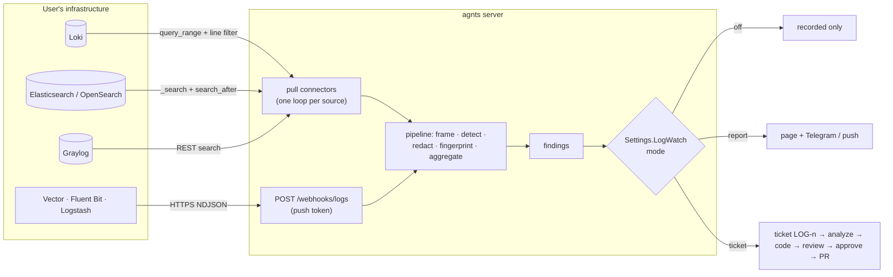

# agnts Log watcher (logs → findings → report or ticket) — Plan

Nov 2, 2026 · draft, revised: v1 connects to the user's logging systems · supersedes `Incidents plan.md` (never
implemented; its on-host Docker watcher becomes phase 3) · copies the shape of `ciwatch` · reaches private loggers
through `Multi VPN plan.md`'s private networks

## Overview

agnts fixes what it is told about: Jira and Plane tickets, local tasks, red CI. What happens in production reaches it
only when someone reads the logs and files a ticket. This plan adds a **log watcher**: the user points agnts at the
logging system they already run (Grafana Loki, Elasticsearch/OpenSearch, Graylog) by entering its address, or points
their log shipper at agnts. agnts reads the logs, finds **errors** (exceptions, panics, 5xx storms) and **security
mistakes** (secrets and personal data written to logs, stack traces sent to clients, debug mode in production,
brute-force bursts), groups them into **findings**, and then, as **Settings → Log watcher** says, either **reports**
them or **opens a ticket** to fix them.

```
Log watcher                                   3 sources · 22 services · last read 12s ago
┌──────────────────────────────────────────────────────────────────────────────────────────┐
│ ● error     api   panic: assignment to entry in nil map   ×37  4m ago      → LOG-12 fixing│
│             billing/coupon.go:88 · api@3f9c1a2 · Loki (prod)                             │
│ ● security  api   Bearer token written to log (auth/mw.go) ×910 1h ago     → LOG-13      │
│             high · rotate the tokens seen since 09:12 · masked: eyJh…Q4                  │
│ ● security  web   42 failed logins from 1 IP in 60 s       ×3   2h ago     reported      │
│             attack, not a code bug · consider rate limiting /login                       │
│ ● error     worker  ECONNREFUSED postgres:5432             ×12  6h ago     reported (infra)│
│ ○ error     api   context canceled                         ×4k              muted         │
└──────────────────────────────────────────────────────────────────────────────────────────┘
```

**Goals**

- Connecting takes one form: kind, address, credentials, **Test connection**. A logger on the public internet or on
  the team's private network (behind a VPN agnts already joined) works the same way. Nothing is installed on the
  user's servers.
- A new error or security mistake shows up in agnts within a minute of being logged, with the redacted excerpt,
  service, revision (when the logs carry one) and repository attached.
- **One setting decides what agnts does** with a finding: nothing, report it (page + Telegram/push), or open a ticket.
  Errors and security have separate modes, and a repository or service can override them.
- A ticket goes through the existing pipeline unchanged: analysis, code, checks, review, **your approval**, PR. A cause
  outside the code (a database down, an unset env var) becomes a `bug` report with the remediation, not a bogus diff.
- Cheap: the filtering is pushed into the user's logging system's own query, so agnts receives only candidate lines,
  not the whole log volume. No model call in v1 beyond ticket runs.
- Logs are sensitive and untrusted: held only in memory while they are processed, redacted before anything is stored,
  sealed at rest, wrapped as data in every prompt.

**Out of scope for v1:** storing or searching logs (we keep one redacted sample per finding), Datadog/CloudWatch/
Splunk connectors (phase 3), the on-host agent for servers with no logging system and for container crash/OOM events
(phase 3), Kubernetes events, metrics and latency alerts, blocking attackers, auto-deploying a fix.

**Principles**

1. **Meet the logs where they are.** The user already ships logs somewhere. agnts reads from there (pull), or the
   shipper sends a copy to agnts (push). Either way the entries enter the same pipeline.
2. **Filter at the source.** Each connector turns the detectors' required keywords into the backend's own filter
   (a LogQL line filter, an Elasticsearch query, a Graylog search), so a service logging 10,000 info lines a second
   sends agnts the handful that matter.
3. **An occurrence is not a finding, a finding is not a ticket.** Entries are grouped by fingerprint into findings,
   one per set of repositories (or, without any, per service) and fingerprint across all sources; a finding gets at most one open
   ticket. A crash loop, or 10 replicas, cost the same as one error.
4. **Rules first.** Detectors are regexes and counters: wide, cheap and deterministic. Like `ciwatch`, classification
   is by rules and the ticket's analysis may switch the kind. Model triage is a later, optional step.
5. **Copy what exists.** Group lifecycle, `AutoFix` + `MaxAutoPerDay` and sample sealing from `ciwatch`; private
   addresses through `netroute`; the public-address check from the Swagger tester (`domain.IsPublicIP`); ticket
   creation like `CreateCITicket`.
6. **Report is the safe default.** A fresh install reports and never opens tickets on its own.

## Architecture



Pull connections to a public address go straight out; to an address on one of the workspace's private networks they
go through the private-network gateway (`internal/gateway`, not the AI gateway in `internal/ai`), exactly like
agnts's calls to a private GitLab: `netroute` picks the network from the workspace in the request's context.

## Connecting a logging system

### The source form (Integrations → Log sources → Add source)

| Field | Notes |
| --- | --- |
| Kind | Loki · Elasticsearch · OpenSearch · Graylog · Push |
| Name, environment | `prod-loki`, `production` / `staging` / `development` (production-only detectors use it) |
| Address | `https://loki.acme.com`, `http://10.0.4.12:3100`, `https://graylog.office.local` |
| Auth | Loki: none · basic · bearer, optional `X-Scope-OrgID` tenant. ES/OpenSearch: API key · basic. Graylog: access token. Sealed like other integration secrets. |
| CA certificate | optional PEM for a private CA; a private network's CA bundle applies automatically. No "skip TLS verification". |
| Scope | Loki: a base selector (`{env="prod"}`). ES: an index pattern (`logs-*`, `filebeat-*`). Graylog: streams. |
| Field names | detected on Test, editable: message, timestamp, level, service, revision (e.g. `service.version`, label `version`) |

**Test connection** checks reachability, auth and permissions, reads the newest entry, and reports the detected
field names and the network used ("via private network Office, 38 ms"). Saving requires a passing test.

### Services and repositories

After a test, agnts **discovers services**: Loki label values (`/loki/api/v1/label/{service label}/values`, trying
`service_name`, `app`, `container`, `job`), an Elasticsearch terms aggregation on the service field, Graylog streams
and sources. The user ticks the services to watch and picks **the repositories** each one runs on, any number of them
or a repository group; agnts pre-fills one when a service name matches a repository name. A service is
`name + selector + repositories`:

- Loki: `{service_name="api"}` (inside the source's base selector).
- ES/OpenSearch: `service.name: "api"` (a term filter).
- Graylog: a stream id, or `source:api`.

**Several repositories** are for services built from more than one: a gateway that fronts the `users`, `billing` and
`orders` services, a monolith with a shared library repository. A ticket for such a service is one multi-repository
ticket (`Ticket.Repos`, as tickets from repository groups are), so the analysis finds which of them the error is in,
and the change touches only the ones that need it.

**No repository selected** is a valid choice: the service's findings are reported on the Log watcher page and never
become tickets, whatever the mode. Selecting repositories later lets the next occurrence (or Fix it) open one.

### Pull connectors

One supervised loop per enabled source on the agnts server, each with its own context, backoff and health. This
differs from `ciwatch`, whose `Tick` runs every 5 minutes for each workspace (`every(sys, 5*time.Minute, …
forEachWorkspace(… a.ci.Tick))` in `serve.go`): a 15 s interval per source doesn't fit one shared tick. Each loop's
context is `domain.WithWorkspace(ctx, source.WorkspaceID)`, so `netroute`, the store and the sealed secrets all act in
the source's workspace. The supervisor reloads the source list when a source is saved and every 5 minutes. Every
connector implements:

```go
// A Puller reads new log entries from a logging system.
type Puller interface {
	Test(ctx context.Context) (TestResult, error)
	Discover(ctx context.Context) ([]domain.LogService, error)
	// Pull returns entries after cur that match the filter, oldest
	// first, and the cursor to resume from. It returns at most limit.
	Pull(ctx context.Context, svcs []domain.LogService, f domain.LogFilter, cur domain.LogCursor, limit int) ([]domain.LogEntry, domain.LogCursor, error)
}
```

| Connector | How it reads | Server-side filter | Cursor |
| --- | --- | --- | --- |
| Loki | `GET /loki/api/v1/query_range?direction=forward&start=…&limit=…` | `{selector} \|~ "(?i)(panic\|error\|exception\|traceback\|bearer\|password\|…)"`, or `\| json \| level=~"error\|fatal"` for JSON logs | last timestamp (ns) + hashes of entries at that timestamp |
| Elasticsearch / OpenSearch | `POST /<index>/_search` sorted by `@timestamp, _doc` (or a tiebreak field), `search_after` | `bool` with `range @timestamp`, the service terms, and `should`: `level` in error/fatal, `match_phrase` on keywords | `search_after` values |
| Graylog | `GET /api/search/universal/absolute` (or the views search API on 5+) | Graylog query string: `streams:… AND (level:<=3 OR message:(panic OR exception …))` | last timestamp + message ids at it |

Polling, not tailing: it resumes exactly from a saved cursor after a restart or an outage, behaves the same for all
three, and doesn't hold a Loki tail slot (`max_concurrent_tail_requests` is 10 by default).

**Poll interval:** 15 s for every source by default, which keeps findings within a minute. Each source can set its own
(**Poll every**, 5 s to 5 min on the source form), e.g. 60 s for a large shared Elasticsearch whose owners want less
load. The interval is read on every loop, so a change applies without restarting the source.

**Limits and catching up.**

- First connect reads from *now* (an option reads the last hour once).
- A poll returns at most 5,000 entries; a source that keeps hitting the cap polls again at once, up to 50,000 entries a
  minute, then is marked **falling behind** and the overflow is counted.
- After an outage longer than an hour, the cursor jumps to *now − 1 h* and the gap is shown on the source ("missed
  09:00–11:30").
- Errors back off (15 s → 5 min). Auth failures stop the source and notify once ("prod-loki: token rejected").
- Health on the source page: connected, last read, lag, entries per minute, last error, network used.

### Push endpoint

For setups where agnts can't reach the logger, or there is no logger with an API: the user's shipper sends a copy of
the logs to agnts. Adding a Push source shows a token and ready snippets.

- `POST https://<agnts>/webhooks/logs` with `Authorization: Bearer <token>` (or `/webhooks/logs/{token}` for shippers
  that can't set headers).
- Body: NDJSON (one JSON object per line), a JSON array, or `text/plain` lines. gzip accepted.
- Fields read in order: message `message|msg|log|_msg|short_message`; time `@timestamp|timestamp|time|ts`; level
  `level|severity|log.level`; service `service|service.name|container_name|app` or the source's default service.
- 5 MB per request, rate limited per token; 202 on accept, 429 with `Retry-After` when over the limit so shippers
  back off and buffer.

```toml
# Vector: send only error-ish lines to agnts
[transforms.agnts_filter]
type = "filter"
inputs = ["app_logs"]
condition = 'match(string!(.message), r''(?i)panic|error|exception|traceback|bearer|password'') || includes(["error","fatal"], .level)'

[sinks.agnts]
type = "http"
inputs = ["agnts_filter"]
uri = "https://agnts.example.com/webhooks/logs"
encoding.codec = "json"
framing.method = "newline_delimited"
auth.strategy = "bearer"
auth.token = "${AGNTS_LOG_TOKEN}"
compression = "gzip"
```

```ini
# Fluent Bit
[OUTPUT]
    Name         http
    Match        app.*
    Host         agnts.example.com
    Port         443
    URI          /webhooks/logs
    Format       json_lines
    Header       Authorization Bearer ${AGNTS_LOG_TOKEN}
    Compress     gzip
    tls          On
```

The snippets filter before sending; the admin says so ("send errors only; agnts drops the rest anyway"). Loki's own
push API (`/loki/api/v1/push`, protobuf + snappy, for Promtail and Grafana Alloy) is phase 2.

### Network and address safety

A user-entered address makes agnts open connections on their behalf, so:

- The host is resolved **at dial time** (a custom `DialContext`, so DNS rebinding can't swap the address after the
  check). If `netroute` matches it to one of the workspace's private networks, the connection goes through that
  network's tunnel. Otherwise every resolved IP must pass `domain.IsPublicIP`: no loopback, RFC 1918, CGNAT,
  link-local (cloud metadata `169.254.169.254`), or the agnts host's own addresses.
- Public addresses must use `https` (credentials cross the internet). `http` is allowed only through a private network,
  whose tunnel encrypts it.
- Redirects are not followed to another host; responses are size-capped and time-limited.
- A source belongs to one workspace and only that workspace's networks are considered.

## Processing (shared by pull, push and the later agent)

`logwatch.Ingest(ctx, source, []domain.LogEntry)` runs the same steps on every batch, in memory:

1. **Frame.** Group entries by stream (Loki labels, the service field) and join multi-line entries that arrive as
   separate lines (Go goroutine dumps, Python tracebacks, Java `Caused by`, Node stacks), capped at 64 KB. Parse JSON
   messages (`level`, `msg`, `error`, `stack`, `status`, `path`, `ip`, `caller`).
2. **Prefilter.** One literal-substring pass (an Aho-Corasick automaton built from every detector's required literals)
   plus the level; entries that pass neither are dropped before any regex. The same literals generate the connectors'
   server-side filters, so the two never disagree.
3. **Detect** on the raw entry (detector sets below). Secret and personal-data detectors record only the kind, the mask
   (`eyJh…Q4`) and an HMAC.
4. **Redact.** `domain.Redact` (`domain/fingerprint.go`: bearer tokens, JWTs, cloud and API keys,
   `scheme://user:pass@`, `password=…`, emails) plus `domain.LooksLikeSecret` values. Only redacted text is ever
   stored, shown or sent to a model.
5. **Fingerprint** with a new `domain.LogFingerprint`: exception type + message + top in-app frames, each through
   `domain.NormalizeLine`. (`domain.Fingerprint` keys on CI jobs and failing tests, so it isn't reused.) Security
   findings fingerprint by detector + logger call site, or the normalized redacted message template. Rate findings by
   detector + route.
6. **Aggregate** per fingerprint within the batch (count, first and last time, up to 300 lines of context), then
   `UpsertLogFinding` once per fingerprint.

Raw entries are never written to disk or the database; a batch lives in memory for the length of one `Ingest` call.

### Error detectors

Level `error`/`fatal`/`panic` (from the parsed level or the configured level field), the error starts already in
`domain/fingerprint.go` (`panic:`, `Traceback`, `Exception in thread`, …), unhandled-rejection and uncaught-exception
banners, and from phase 2 HTTP 5xx in access logs as a rate (≥ N per minute per route). Crash and OOM *events* need
the agent (phase 3); a panic that the app logged is found from the log.

### Security detectors

| Detector | Example | Default class | Ticket-able | Phase |
| --- | --- | --- | --- | --- |
| Secret in logs | `Authorization: Bearer eyJ…`, `password=…`, AWS key, DSN with password | `leak` · high | yes: stop logging it, plus "rotate" in the report | 0 |
| Personal data in logs | emails, phone numbers, card numbers (Luhn) in bulk | `leak` · medium | yes | 1 |
| Stack trace or SQL error in a response | access log 500 whose logged response body has a trace, `pq:`/`SQLSTATE` | `exposure` · medium | yes | 1 |
| Debug mode in production | `GIN_MODE=debug`, Django `DEBUG=True`, Flask debugger banner; production sources only | `config` · medium | report (config) | 1 |
| Brute force / credential stuffing | ≥ 20 failed logins from one IP or for one account in 60 s | `attack` · medium | after repeats: a hardening ticket (rate limiting, lockout) | 2 |
| Scanning | bursts of probes on `/.env`, `/wp-admin`, `/.git/config` | `attack` · low | after repeats: a hardening ticket; a probe answered 2xx is `exposure` · high at once | 2 |
| Injection reaching the DB (best effort) | a SQL syntax error whose entry also logs the input, and the input carries `' OR`, `UNION SELECT` | `weakness` · high | yes | 3 |

`attack` findings describe what someone did to you, so one burst is only reported. **When the same attack keeps
coming** (the same detector on the same route reaches `AttackTicketAfter` bursts within 7 days, default 3), it is no
longer bad luck but a missing defence, and the finding becomes ticket-able as a **hardening ticket**: "add rate
limiting and lockout to `POST /login`", "return 404 and log less for unknown paths". It follows the same mode, repository
and budget rules as any ticket. A scan whose probe got a 2xx (`/.env` served) is not an attack finding at all but
`exposure` · high, ticket-able at once. When an attack shows a real weakness (an injection that produced a SQL error)
the finding is `weakness` and can become a ticket on the first occurrence. The injection detector fires only when
the app logs the input next to the error. Custom patterns per workspace (`Settings.LogWatch.Patterns`) add detectors
of either category (and their literals join the server-side filter).

**Keyed secret hashes.** A plain sha256 of a logged password or short token can be brute-forced. Secret findings carry
`HMAC-SHA256(k, value)` with a per-workspace key sealed with `AGNTS_ENC_KEY`, so two services leaking the same token
land in one finding without the value being stored anywhere.

## Server side

### Package layout (Clean Architecture, as elsewhere)

- **`domain/logwatch.go`**: `LogSource` (kind, address, environment, scope, field names, status), `LogService`,
  `LogEntry`, `LogCursor`, `LogFilter`, `LogFinding`, `LogCategory` (`error`, `security`), `LogClass` (`code`,
  `config`, `infra`, `dependency`, `leak`, `exposure`, `weakness`, `attack`, `noise`), `LogStatus` (the `CIStatus`
  set plus `reported`), `SourceLogs TicketSource = "logs"`.
- **`domain/logdetect.go`**: framers, prefilter literals, detectors, `LogFingerprint`, and `FilterTerms()` that the
  connectors turn into queries. Pure; most tests live here.
- **`domain/settings.go`**: `Settings.LogWatch LogWatchSettings` with `Validate()` and defaults like `CISettings`.
  Workspace-level like `CI`: `Settings.For(Access)` leaves it unchanged.
- **`internal/logsource/`** (adapters): `loki/`, `elastic/` (Elasticsearch and OpenSearch share it; the differences are
  the version probe and auth headers), `graylog/`, each a `Puller`; `push.go` parses push bodies into `LogEntry`s;
  `dial.go` is the address-safety dialer on top of `netroute`.
- **`internal/logwatch/`** (use case), mirroring `ciwatch`:
  - `Store`, `Tickets`, `Work`, `Notifier`, `Pullers` (a factory by kind) interfaces it declares.
  - `Run(ctx)`: the supervisor that starts, stops and restarts one loop per enabled source when sources change.
  - `Ingest`, `act` (policy), `Fix`, `Notify`, `Mute`/`Unmute`, `SetServiceRepos`, `CheckRegression`, `Sweep`, `Digest`.
- **`store/postgres/logwatch.go`**, **`httpapi`** handlers, **`notify`** events, **`mcpserver`** tools (phase 2).
- **`orchestrator`**: `CreateLogTicket(ctx, LogTicketInput, origin)` next to `CreateCITicket`, with a `LOG` prefix;
  a prompt section for `Source = logs`; the merge webhook marks the finding `fixed`.

### Upsert and the sample

`UpsertLogFinding` is one `INSERT … ON CONFLICT (workspace_id, scope, fingerprint) DO UPDATE`, so two sources or
replicas reporting the same bug don't race. It bumps `count`, `last_seen_at` and the hourly bucket, and appends to
`occurrences` (last 20, each with source, service, revision and time). It **replaces the sealed sample only** when the
finding is new, its status changed, or the stored sample is older than 10 minutes.

`scope` is `repos:<sorted repository ids>` for services with repositories (`repos:3,7,12` for a gateway) and
`svc:<source id>/<service>` for services without. So the same bug from two sources of the same service lands in one
finding. Selecting repositories for a service later merges its findings into the new scope (counts summed, oldest
`first_seen_at` kept); changing them does the same.

### What happens to a finding: the setting

```go
// LogWatchSettings: how agnts watches project logs and what it does with
// what it finds. Workspace-level, like CISettings.
type LogWatchSettings struct {
	// Errors and Security say what to do with a finding of that category:
	// "off" records it only, "report" shows and notifies, "ticket" also
	// opens a ticket (for classes that can be fixed in code, on services
	// with repositories). Both default to "report": automatic tickets are
	// off until someone turns them on.
	Errors   LogMode `json:"errors"`   // default "report"
	Security LogMode `json:"security"` // default "report"
	// AlwaysNotifyLeaks notifies leak findings of high severity or above
	// even when Security is "off": a secret leaking into logs is a live
	// incident. Default true.
	AlwaysNotifyLeaks bool `json:"alwaysNotifyLeaks"`
	// MinSeverity is the lowest severity that is reported or ticketed.
	MinSeverity string `json:"minSeverity"` // low, medium, high, critical; default "medium"
	// Threshold is how many occurrences within the hour a finding needs
	// before it acts; panics and leaks act on the first one.
	Threshold int `json:"threshold"` // default 3, 1..1000
	// MaxAutoPerDay caps automatic tickets a day (Fix it is not capped).
	MaxAutoPerDay int `json:"maxAutoPerDay"` // default 5, 0..50
	// AttackTicketAfter: an attack finding (brute force, scanning) on one
	// route becomes ticket-able as a hardening ticket after this many
	// bursts within 7 days; 0 never.
	AttackTicketAfter int `json:"attackTicketAfter"` // default 3, 0..50
	// ResolveAfterDays: a fixed finding with no revision to check is
	// resolved after this many quiet days.
	ResolveAfterDays int `json:"resolveAfterDays"` // default 3, 1..30
	// Digest sends one daily summary instead of a message per finding.
	Digest bool `json:"digest"`
	// Patterns are extra detectors.
	Patterns []LogPattern `json:"patterns"`
	// Overrides change the modes for one repository or service.
	Overrides []LogOverride `json:"overrides"`
}
```

**Threshold window.** `count` is the lifetime total. "N within the hour" uses `hour_count` and `hour_start` on the
finding: the upsert resets `hour_count` when `hour_start` is more than an hour old, else adds to it. A fixed hourly
bucket, not a sliding window; enough for "is this happening a lot".

**Policy** (`logwatch.act`), evaluated when a finding is new, regresses, or crosses its threshold:

1. Mode for the category, after overrides (most specific wins: service → repository → workspace).
2. `off` → recorded, grey on the page, no notification. Exception: a `leak` of high severity or above is still
   notified when `AlwaysNotifyLeaks` is on.
3. Below `MinSeverity` or `Threshold`, muted, or class `noise` → recorded.
4. `report` → status `reported`, notify once per finding (or add to the digest). The page shows **Fix it** for
   ticket-able classes.
5. `ticket` → only for ticket-able classes (`code`, `dependency`, `leak`, `exposure`, `weakness`, and `attack` once it
   reached `AttackTicketAfter`), on a service with at least one repository, no open ticket for this finding, and
   `MaxAutoPerDay` has room; otherwise it falls back to `report` with the reason ("budget reached", "no repository
   selected", "not a code bug"). `config`/`infra` open a **`bug` report ticket** only when someone presses Fix it.
   A service with no repository only ever gets reports, and Fix it on its findings asks to select repositories first.
6. A finding with an open ticket appends new counts to the ticket's log instead of notifying again.

**The ticket** (`CreateLogTicket`, like `CreateCITicket`) is created **directly in agnts** for the service's
repositories, not filed in Jira or Plane: `Source = logs`, key `LOG-n`, `Kind = code`, `KindAuto = true` (the analysis
may switch to `bug`), `AskFirst = false`, priority from severity (`critical` → `highest`, `high` → `high`, else
`medium`), `AfterApprove = "pr"`.

- **Repositories:** every repository selected for the service, in `Ticket.Repos`; `RepoID` (the primary, which gives
  the key prefix and filters) is the one the stack trace's files belong to when agnts can tell from the paths, else the
  first selected. With several, the prompt says "the error came through <service>; find which of these repositories
  it is in and change only those". A repository the run didn't change ends `RepoUnchanged` and gets no PR, as in any
  multi-repository ticket.
- **Who it runs as, and on what:** like a CI ticket, nobody created it, so the AI gateway routes its stages for the
  workspace's default member (else the owner): that person's modules, the stage models in Settings (which may now be a
  tier, `tier:light` / `tier:strong`), `SwitchModules` when their module can't run, and the usual funding (their
  connected account, else credits). Nothing log-specific is needed in the gateway; ticket stages already have
  `Policy{Credits: true, Reroute: true}`.
- **Description:** title, service, source, revision, counts, the first error block and a link back to the logger when
  it has one (a Grafana Explore URL, a Kibana Discover URL, a Graylog search); the full redacted excerpt attached as
  `log-excerpt.txt`. Security tickets never put the masked secret or any excerpt in the PR body, only the title and
  location.

**Prompt section** for `Source = logs`: start from the logged revision when there is one (`git log <revision>..HEAD --
<files>`; "already fixed on main, not deployed" → no change, a short report), root cause not symptom, reproduce with a
failing test first, minimal change. For `leak`: remove or mask the value at the logger call site and add a test that
the log line no longer contains it; the report says which secrets to rotate. For a hardening ticket (`attack`): add the
missing defence on that route (rate limit, lockout, generic error) with a test, using what the codebase already has
(an existing rate limiter or middleware) before adding a dependency.

### Lifecycle

```
 entry ──► open ──(policy: report)──► reported ──Fix it──┐
             │                                           ▼
             └──────(policy: ticket)──────────────► fixing (LOG-n) ──merge──► fixed ──quiet──► resolved
  mute ◄── any                                                                  │
                                       it happens again after the fix  ◄────────┘
                                       (regression, or "recurred")
```

- **With a revision field** (the service's logs carry the deployed commit or a version agnts can map to one):
  resolved after 24 h of entries from a revision that contains the merge commit with no occurrence; the same
  fingerprint on such a revision is a **regression** (`git merge-base --is-ancestor` in agnts's clone).
- **Without one:** resolved after `ResolveAfterDays` quiet days after the merge. An occurrence after the merge marks it
  **recurred** ("seen again after the fix merged; it may not be deployed yet").

A regression reopens the finding and adds a follow-up to the old ticket; it does not open a second one automatically.

### Data model — migration `00076_log_watch.sql`

```sql
CREATE TABLE log_sources (
  id            bigserial PRIMARY KEY,
  workspace_id  bigint      NOT NULL DEFAULT agnts_ws() REFERENCES workspaces (id) ON DELETE CASCADE,
  name          text        NOT NULL,
  kind          text        NOT NULL,              -- loki, elasticsearch, opensearch, graylog, push
  environment   text        NOT NULL DEFAULT 'production',
  address       text        NOT NULL DEFAULT '',   -- '' for push
  auth          bytea,                             -- sealed: kind, user, password, token, tenant
  ca_pem        text        NOT NULL DEFAULT '',
  scope         jsonb       NOT NULL DEFAULT '{}', -- base selector, index pattern, streams
  fields        jsonb       NOT NULL DEFAULT '{}', -- message, timestamp, level, service, revision
  push_token_hash bytea     UNIQUE,                -- push only
  poll_seconds  integer     NOT NULL DEFAULT 15 CHECK (poll_seconds BETWEEN 5 AND 300),
  enabled       boolean     NOT NULL DEFAULT true,
  cursor        jsonb       NOT NULL DEFAULT '{}',
  status        text        NOT NULL DEFAULT 'new', -- new, ok, behind, failing, auth_failed
  last_error    text        NOT NULL DEFAULT '',
  last_read_at  timestamptz,
  network_id    bigint,                            -- the private network last used, for display
  created_at    timestamptz NOT NULL DEFAULT now(),
  UNIQUE (workspace_id, name)
);

CREATE TABLE log_services (
  id          bigserial PRIMARY KEY,
  source_id   bigint NOT NULL REFERENCES log_sources ON DELETE CASCADE,
  name        text   NOT NULL,
  selector    text   NOT NULL,       -- LogQL matcher, ES term, Graylog stream/query
  group_id    bigint REFERENCES repository_groups ON DELETE SET NULL, -- picked from a group, for display
  enabled     boolean NOT NULL DEFAULT true,
  UNIQUE (source_id, name)
);

CREATE TABLE log_service_repos (     -- the repositories a service runs on; none: report only
  service_id  bigint  NOT NULL REFERENCES log_services ON DELETE CASCADE,
  repo_id     bigint  NOT NULL REFERENCES repositories ON DELETE CASCADE,
  position    integer NOT NULL DEFAULT 0,
  PRIMARY KEY (service_id, repo_id)
);

-- workspaces.log_hmac_key bytea: the per-workspace secret-hash key, sealed with AGNTS_ENC_KEY.

CREATE TABLE log_findings (          -- one per workspace + repositories (or service) + fingerprint
  id            bigserial PRIMARY KEY,
  workspace_id  bigint      NOT NULL DEFAULT agnts_ws() REFERENCES workspaces (id) ON DELETE CASCADE,
  scope         text        NOT NULL,              -- repos:<sorted ids> or svc:<source id>/<service>
  service_id    bigint      REFERENCES log_services ON DELETE SET NULL,
  service       text        NOT NULL,
  route         text        NOT NULL DEFAULT '',   -- rate and attack findings
  bursts        jsonb       NOT NULL DEFAULT '[]', -- attack only: burst times in the last 7 days
  category      text        NOT NULL,              -- error, security
  detector      text        NOT NULL,              -- panic, exception, secret, brute_force, ...
  class         text        NOT NULL DEFAULT '',
  severity      text        NOT NULL DEFAULT 'medium',
  fingerprint   text        NOT NULL,
  title         text        NOT NULL,
  remediation   text        NOT NULL DEFAULT '',
  status        text        NOT NULL DEFAULT 'open',
  count         bigint      NOT NULL DEFAULT 1,
  hour_count    integer     NOT NULL DEFAULT 1,
  hour_start    timestamptz NOT NULL DEFAULT now(),
  first_seen_at timestamptz NOT NULL,
  last_seen_at  timestamptz NOT NULL,
  revision      text        NOT NULL DEFAULT '',
  secret_mask   text        NOT NULL DEFAULT '',   -- leak only: "eyJh…Q4"; never the value
  secret_hmac   bytea,
  sample        bytea,                             -- redacted excerpt, sealed with AGNTS_ENC_KEY
  sample_at     timestamptz,
  occurrences   jsonb       NOT NULL DEFAULT '[]', -- last 20: time, source, service, revision, link
  reported_at   timestamptz,
  ticket_key    text        REFERENCES tickets(key) ON DELETE SET NULL,
  fixed_sha     text        NOT NULL DEFAULT '',
  fixed_at      timestamptz,
  UNIQUE (workspace_id, scope, fingerprint)
);
CREATE INDEX log_findings_active ON log_findings (workspace_id, status, last_seen_at DESC);
```

Retention: `logwatch.Tick` runs every 5 minutes for each workspace, wired in `serve.go` next to `a.ci.Tick`
(`every(sys, 5*time.Minute, … forEachWorkspace …)`). It calls `Sweep`, which resolves quiet fixed findings
and drops `sample` of resolved and muted findings after 30 days.

### API (`openapi.yaml`, then `make gen`)

- `GET/POST /log-sources`, `GET/PUT/DELETE /log-sources/{id}`, `POST /log-sources/test` (test an unsaved form),
  `POST /log-sources/{id}/test`, `GET /log-sources/{id}/discover`, `GET/PUT /log-sources/{id}/services`,
  `POST /log-sources/{id}/push-token` (push: create or rotate).
- `POST /webhooks/logs` and `/webhooks/logs/{token}` (push). Not behind `webhookWorkspace`: like
  `/webhooks/swagger-suite/{token}`, the token names the source and its workspace. Size limit, gzip, rate limit per
  token, 401 for unknown or revoked tokens.
- `GET /log-findings` (filters: category, status, severity, repo, source), `GET /log-findings/{id}`,
  `POST /log-findings/{id}/fix`, `/notify`, `/mute`, `/unmute`.
- Settings via the existing `GET/PUT /settings` (`logWatch` object).

### Admin, notifications, mobile

- **Integrations → Log sources**: the list with health (connected, lag, entries/min, network used, last error), Add
  source (the form above with Test connection), and per source the discovered services with their repositories.
- **Log watcher** page (new nav item, next to CI): findings, tabs Errors / Security, filters, sparkline per finding,
  actions **Fix it**, **Notify**, **Mute**, **Open in Grafana/Kibana/Graylog**. Detail: remediation, redacted excerpt
  with the first error block highlighted, occurrences, revisions, ticket.
- **Settings → Log watcher**: *Errors: Off · Report · Open ticket* and *Security: Off · Report · Open ticket* (both on
  Report on a new install), then "always notify secret leaks", minimum severity, threshold, "ticket repeated attacks
  after N bursts", daily ticket cap, digest, custom patterns, overrides.
- **Source form**: Poll every (default 15 s); per service a multi-select of repositories (or a repository group) with
  "none: report only" as the empty state.
- **Ticket page**: a finding card above the description for `Source = logs`.
- **notify**: `EventLogFinding` once per finding: "api: Bearer token written to log, high, ×910 — rotate tokens; Fix
  it". Telegram gets **Fix it** and **Mute** buttons, like `ciFailure`. Source failures notify once per outage.
- **Mobile**: the push opens the finding; Fix it from the phone.
- All strings in `shared/i18n` (EN/RU/UZ).

## Phases

**v1 = phases 0 and 1.**

**0 — First source, report only.** Loki connector and the push endpoint (NDJSON, Vector/Fluent Bit snippets), the
address-safety dialer with private networks, Test connection, discovery and service mapping, the processing pipeline
with panic/exception and secret-in-logs detectors, findings table and upsert, Log watcher page, Settings with modes
`off`/`report`, Telegram notification. Done when a test service logging a panic and a bearer token into a Loki on a
private network, and the same into the push endpoint, gives two findings (not four) with the right titles and a masked
token.

**1 — All v1 sources, tickets.** Elasticsearch/OpenSearch and Graylog connectors; mode `ticket` with policy and budget,
`CreateLogTicket`, prompt section, finding card, merge → fixed, regression and recurred; personal-data, exposure and
debug-mode detectors; `AlwaysNotifyLeaks`; Fix it / Mute from Telegram; source health and failure notifications;
deep links back to the logger.

**2 — Breadth.** Loki push API (Promtail, Alloy), rate detectors (5xx storms, brute force, scanning) with hardening
tickets after `AttackTicketAfter`, overrides, digest, MCP tools, mobile list, and optional model triage if rule titles
prove too poor. Triage would be one call per new finding through the AI gateway (`gw.Route` then `gw.Run`):
- a new purpose, `domain.PurposeLogTriage`, next to `PurposeDetect` in `domain/transcript.go`;
- `ai.Who{Workspace: ws}` (the default person);
- `ai.Want{Model: domain.TierLight}`, the light model of whatever module that person has;
- funding and `SwitchModules` decided by the gateway, with the purpose's policy set in `ai.PolicyOf`;
- a per-day cap in `Settings.LogWatch`.

The gateway records the spend and the transcript, so `logwatch` writes neither.

**3 — Beyond logging systems.** The on-host agent `agnts-watch` (from `Incidents plan.md`: Docker events for crash/OOM/
unhealthy, container logs, files, journald) for servers with no logging system; Datadog, CloudWatch and Splunk
connectors; the best-effort injection detector.

## Testing

- `domain`: framers on real Go/Python/Node/Java/JSON logs split into single lines as Loki and ES return them; each
  security detector with positives and near-misses; the prefilter never drops an entry a detector would match
  (property test over the detector corpus); `FilterTerms` covers every detector literal; fingerprint stability;
  detectors run on raw text and the stored sample never contains a secret.
- `logsource`: each connector against recorded responses (`httptest`): paging, cursor resume with duplicate timestamps,
  the 5,000 cap, auth failure, Loki tenant header, ES 7/8 and OpenSearch 2 response shapes, Graylog 5/6 search APIs.
  Integration tests against real Loki, Elasticsearch, OpenSearch and Graylog containers when `AGNTS_TEST_LOGS=1`.
  Push parser: NDJSON, array, text, gzip, field fallbacks, oversize.
- `dial`: private addresses refused without a matching private network; matched ones dial through a fake gateway; DNS
  that answers a public then a private IP is refused at dial time; `http` to a public host refused; redirects to
  another host not followed.
- `logwatch`: policy table tests (mode × class × severity × threshold × budget × repositories none/one/several × open
  ticket × override × `AlwaysNotifyLeaks` × attack bursts below/at `AttackTicketAfter`); a gateway service gives one
  ticket with all its repositories and the stack trace's repository first; changing a service's repositories merges
  its findings; the poll interval change applies on the next loop; hour bucket; supervisor restarts a failing source with backoff and stops on auth failure; the
  catch-up jump after a long outage; regression and recurred.
- `store/postgres`: concurrent upserts from two sources end in one finding; sample replaced only by the rules (fresh
  test DB, see README).
- `httpapi`: push auth, size and rate limits, workspace from the token; source test endpoint never returns the saved
  credentials.
- End to end (`make logwatch-smoke`): compose a tiny Go service, Loki and Promtail; the service panics on one route and
  logs a token on another; add Loki as a source; assert two findings; switch Errors to *Open ticket* and assert a
  `LOG-` ticket with the trace.

## Security

- agnts holds read credentials to the user's logging system; they are sealed at rest, shown masked, never sent to runs,
  and the form recommends a read-only user/token (Loki: a reader tenant token; ES: a role with `read` on the index
  pattern; Graylog: a reader user's token). Test connection warns when the credentials can write.
- User-entered addresses go through the address-safety dialer: private ranges only via the workspace's own private
  networks, public ones only over https, checked at dial time.
- Raw logs live only in memory during processing; only redacted samples are stored, sealed, never sent to
  Jira/Plane/GitHub, and dropped 30 days after resolution. Secrets found in logs are stored as a mask and a keyed HMAC.
- Log lines are attacker-controlled. Every prompt wraps them as data; a run still goes through the guard, egress proxy
  and your approval. A crafted log line can at worst produce a bad diff you reject.
- Caps per poll, per minute and per push token, and grouping per finding, stop a log flood from becoming a ticket flood.

## Costs and limits

- **User's logging system:** one filtered query per source every poll interval (15 s by default). The server-side filter keeps results small;
  for Loki, a query over a 15 s window with a line filter is cheap, and ES queries hit a time range on a sorted index.
- **agnts server:** one goroutine and one HTTP client per source; CPU for one substring pass per returned entry plus
  regexes on the few that pass; one upsert per fingerprint per batch; the 64 KB sample re-sealed at most every 10 min.
- **Model:** none in v1 beyond ticket runs, capped by `MaxAutoPerDay`.

## Decisions (Nov 2, 2026)

1. **Automatic tickets are off by default.** Errors and Security both start on Report.
2. **Tickets are created directly in agnts for the repositories selected on the service**, not filed in Jira or Plane.
   A service can have several repositories (a gateway in front of several services): one multi-repository ticket. A
   service with no repository selected gets reports on the Log watcher page only.
3. **Repeated attacks open hardening tickets.** The same attack on the same route `AttackTicketAfter` times (default
   3) within 7 days becomes ticket-able: rate limiting, lockout and the like.
4. **Poll interval is 15 s by default for every source, and each source can set its own** (5 s to 5 min).
